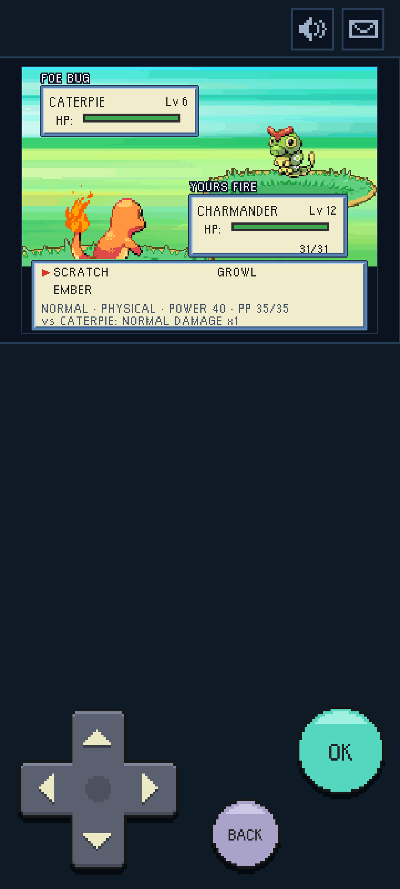
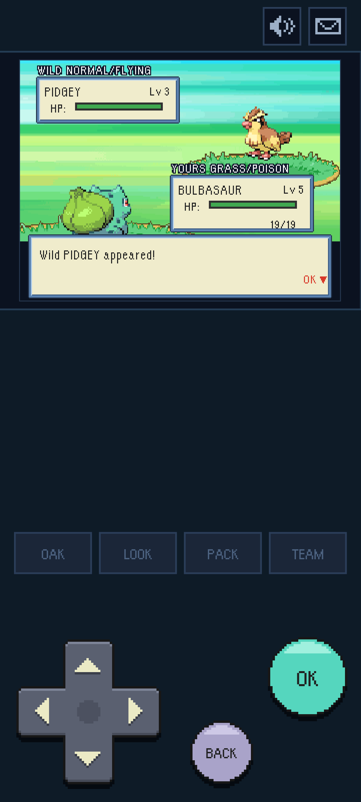
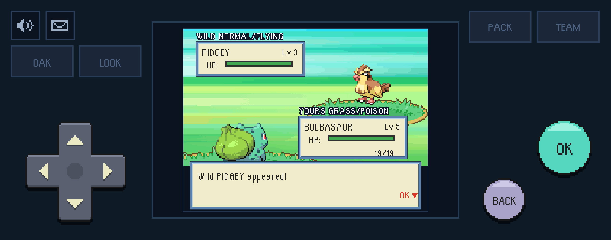
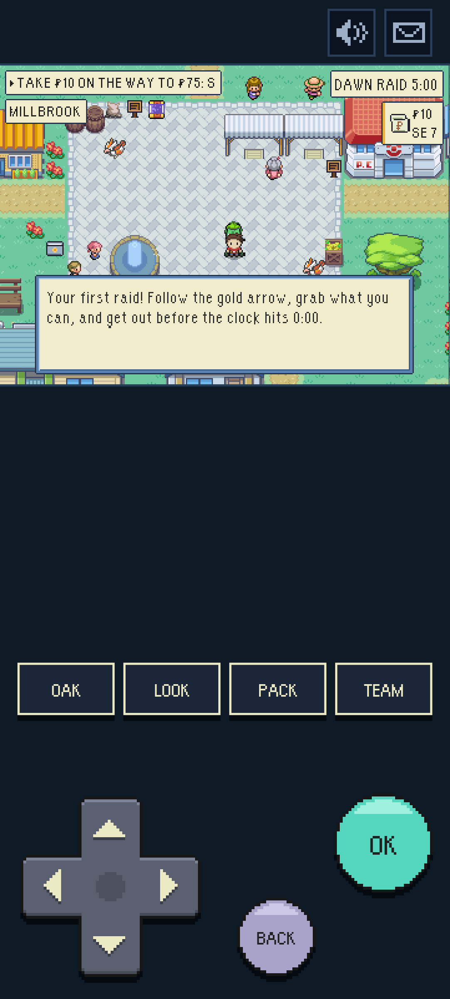
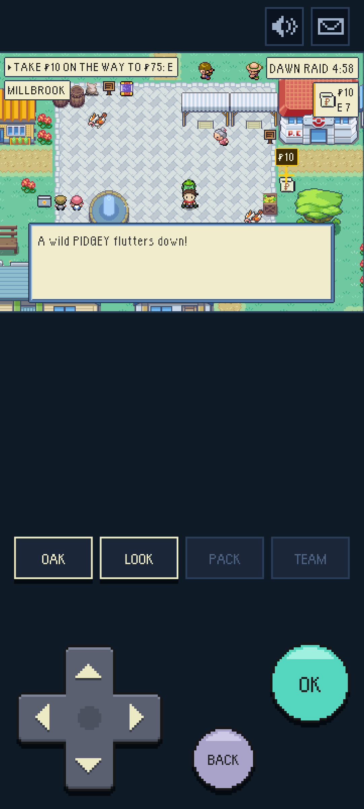

# The tray keeps its shape in a fight and under a line of talk

A fresh critic of the whole phone game found the touch pad's tray vanished in a battle - the screen a player sees most - when everywhere else a key that does nothing stays where it is, dimmed. Now a fight out of a raid leaves the raid's keys standing, dimmed (`BattleScene.dimsTouchTray`), and while a dialogue box waits for OK, PACK and TEAM dim in their places: the raid does not open them then, and OAK and LOOK still answer.

| | before | after |
|---|---|---|
| a fight |  |  |
| a fight, on its side | |  |
| a line waiting for OK |  |  |

(The "before" fight was started from the title for the picture; one out of a raid showed the same empty tray.) Made with `node tools/playtest/phoneTour.mjs <test-mode build url> <dir> --device=...`, which now starts a fight out of the raid.
