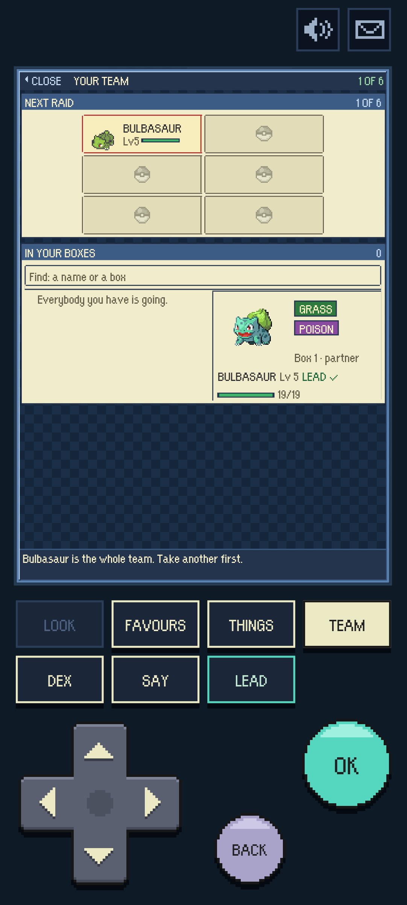
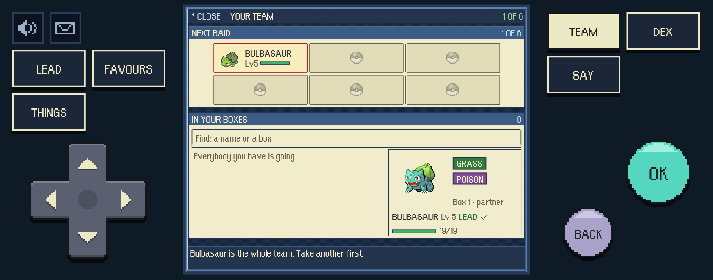
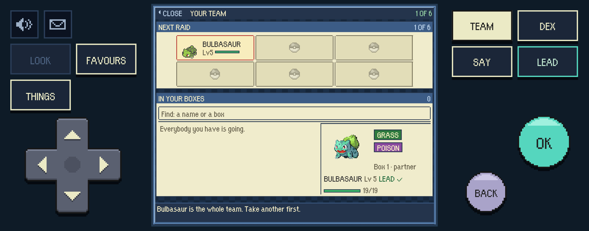

# A key whose letter a screen takes stays where it is

On YOUR TEAM, L is LEAD, and the touch pad used to turn the yard's LOOK key into LEAD in its place: a thumb that knew where LOOK was pressed LEAD. Now LOOK stays where it is, dimmed and dead, and LEAD comes after the yard's keys, framed teal, as any key a screen adds does. SOUND and FEEDBACK are 44 pixels square, a fingertip wide.

| | before | after |
|---|---|---|
| upright |  |  |
| on its side |  |  |

Made with `node tools/playtest/phoneTour.mjs <test-mode build url> <dir> --device=...`.
