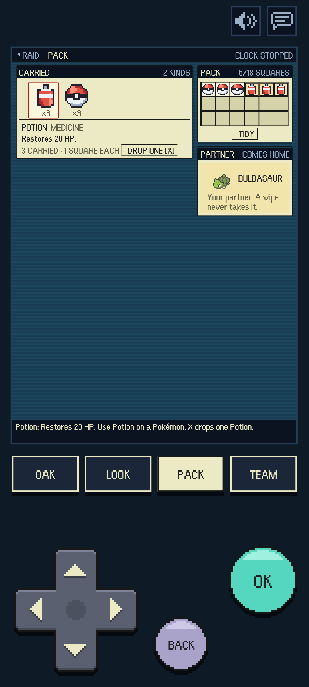
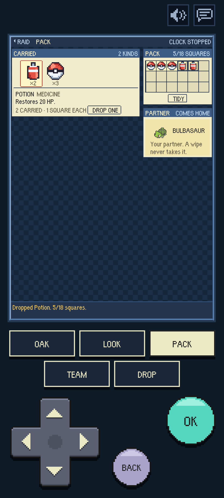
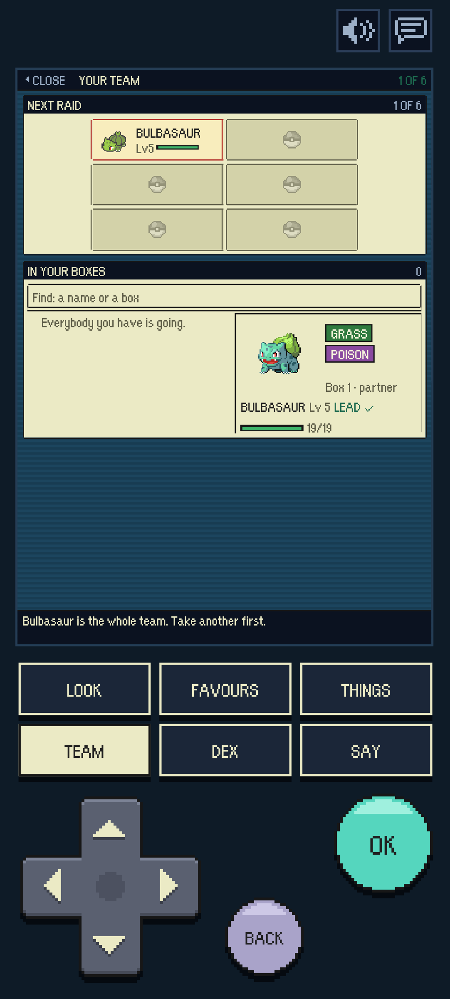
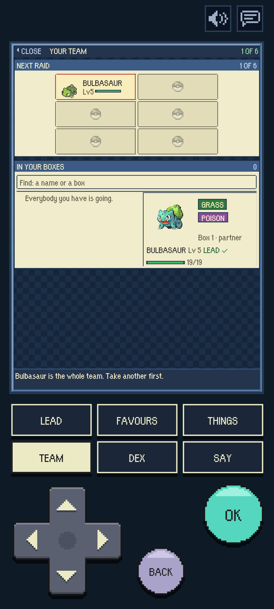

# A menu's own keys on the touch pad

The pack teaches "X drop" and the team "L lead", and a phone had no X or L.
Now a menu's letter keys join the pad's tray while it is up, read off its help
line, and the menu says its keys the pad's way: "DROP ONE [X]" is "DROP ONE",
and its help line's ESC is BACK. The key that opened the screen stays lit.

| | before | after |
|---|---|---|
| raid pack |  |  |
| DROP pressed on the pad | |  |
| YOUR TEAM |  |  |

Made with `node tools/playtest/phoneTour.mjs <test-mode build url> <dir> --device=portrait`,
which presses DROP on the pad and reports the Potions carried before and after (3, then 2).
