# The touch pad

Before, a phone opened on "THIS GAME NEEDS A KEYBOARD, FOR NOW" and could not
walk a step. After, it plays on a pad drawn in the game's own pixels: a d-pad,
OK (SPACE) and BACK (ESC), a tray of the screen's own keys by name (the key
whose screen is open lit), and sound and feedback in the corner. Upright the
game sits on top and the pad below; on its side the pad splits either side.

| | before | after |
|---|---|---|
| upright, title | 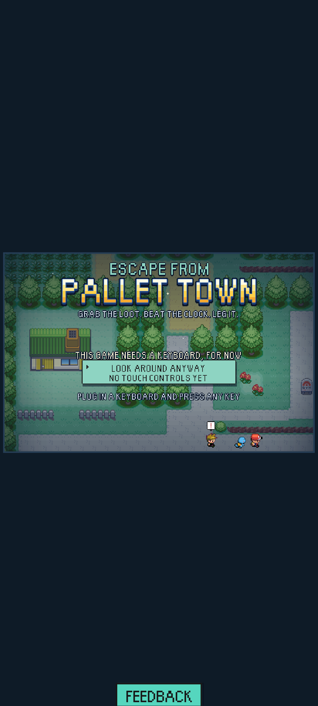 | 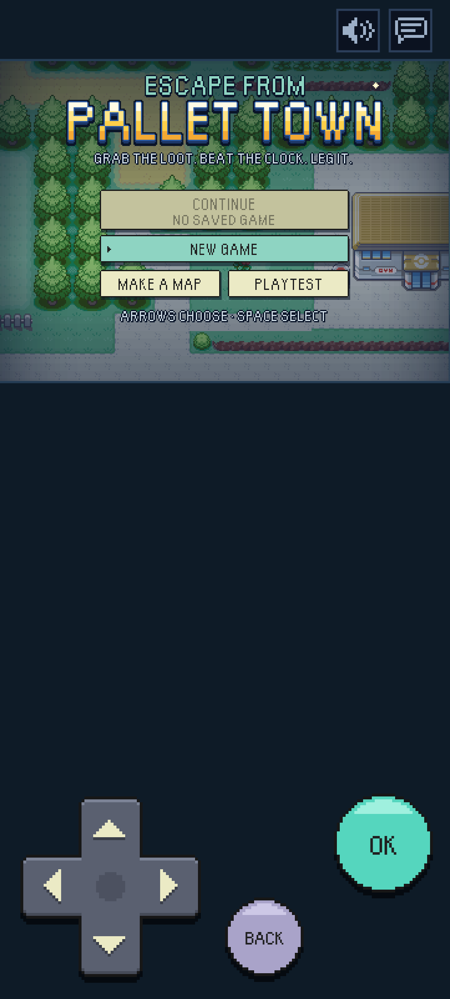 |
| on its side, title | 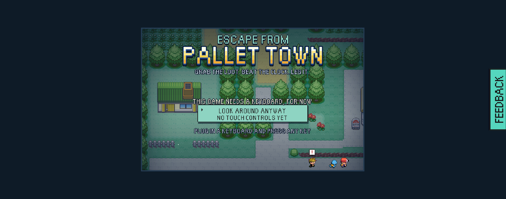 | 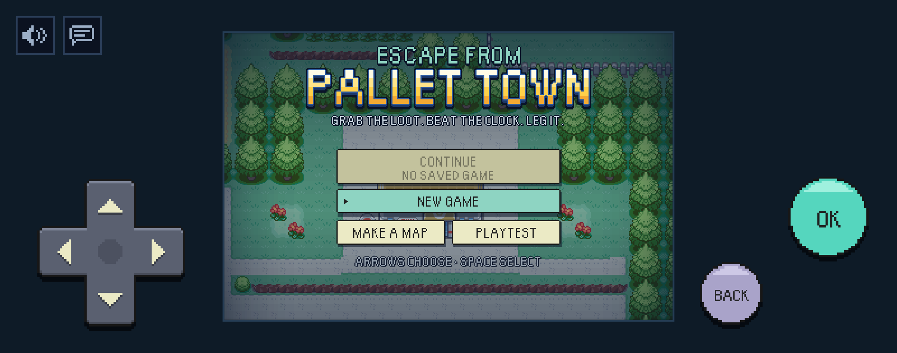 |

After, through a game (412x915 at 2.625; 915x360; 375x667 at 2):

| harbour | YOUR THINGS | raid | raid pack |
|---|---|---|---|
| 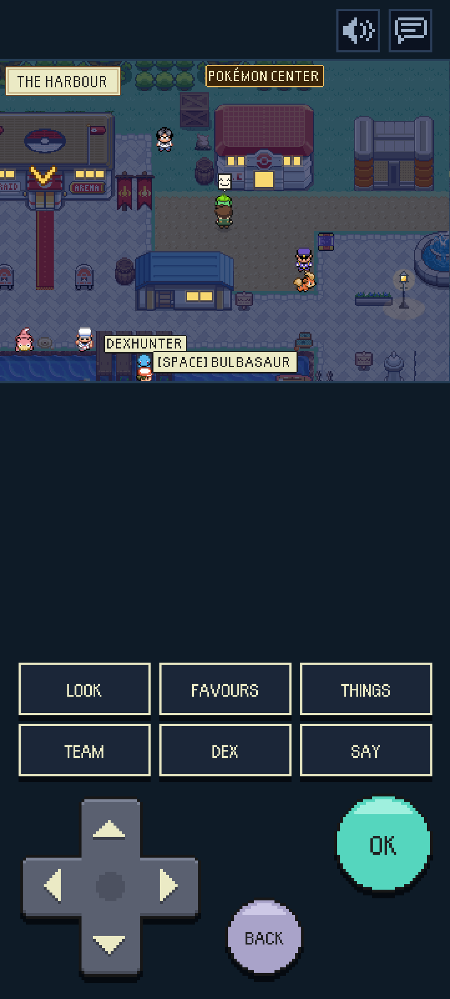 | 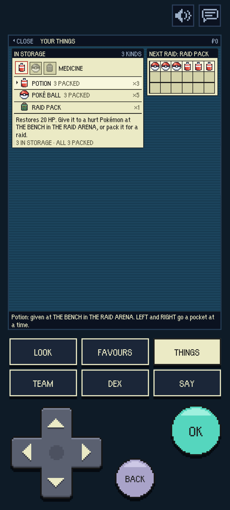 | 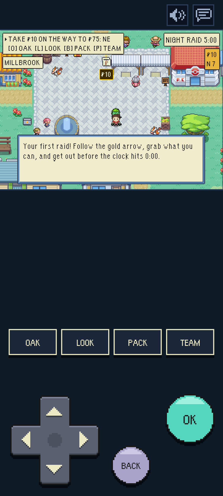 | 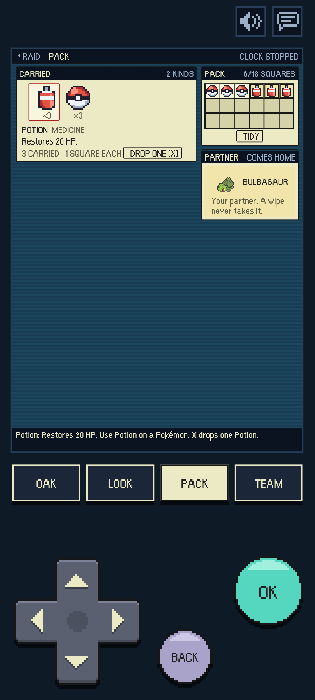 |
| 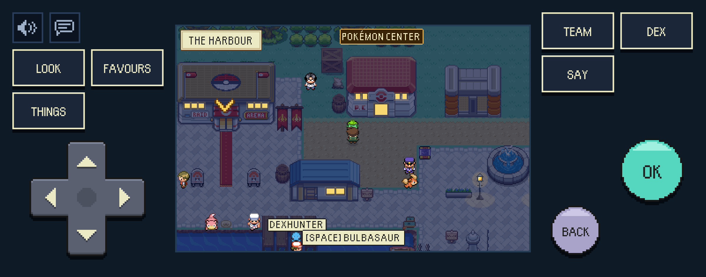 | 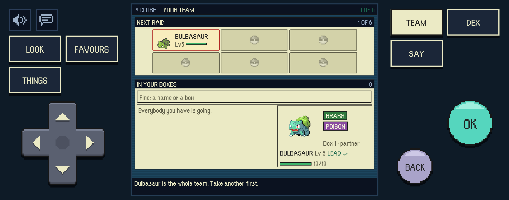 | 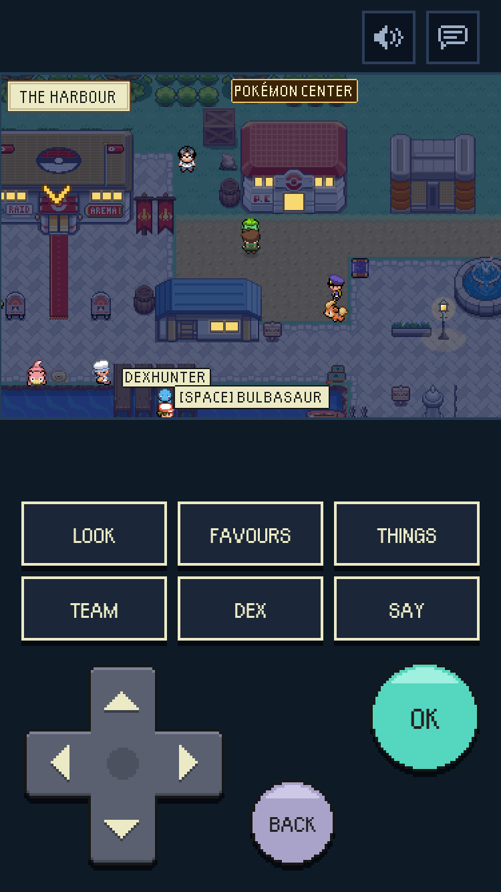 | 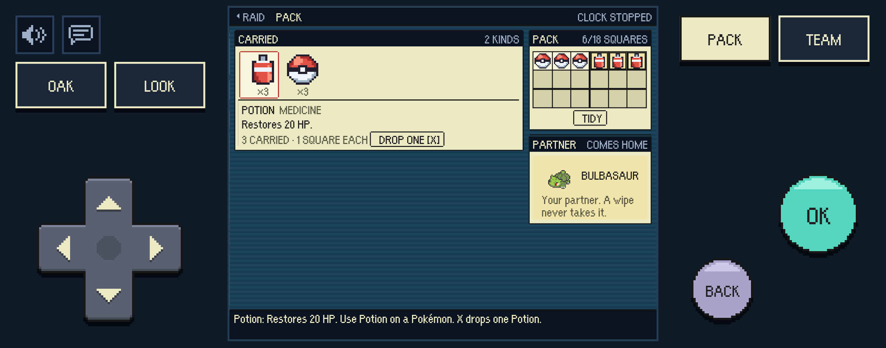 |

Made with `node tools/playtest/phoneTour.mjs <test-mode build url> <dir> --device=portrait`
(and `landscape`, `small`) against a `VITE_EPTW_TEST_MODE=1` build at `?testmode=pixels`.
Two rounds of a fresh critic's review were taken in before these.
