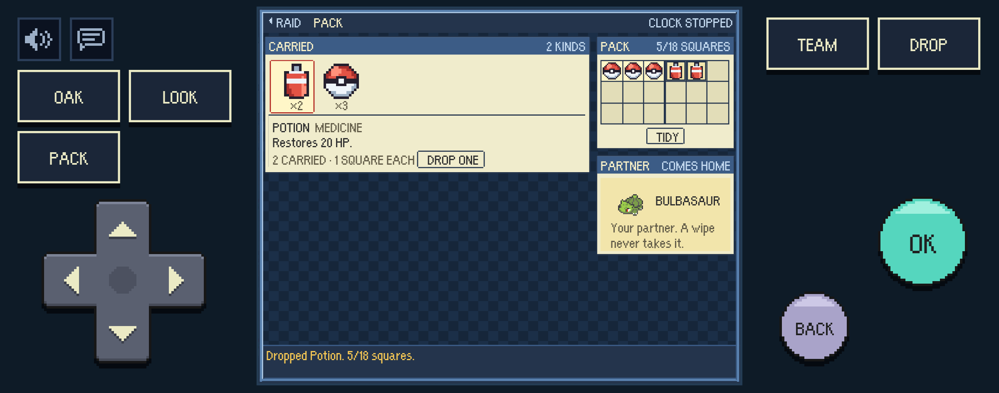
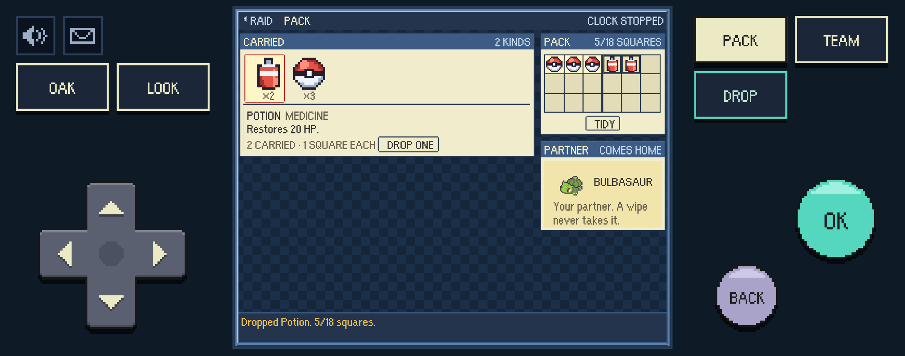
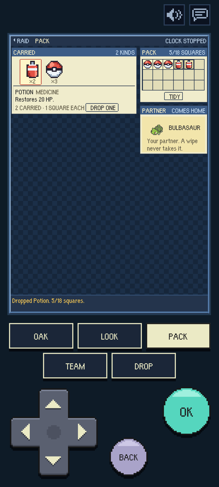
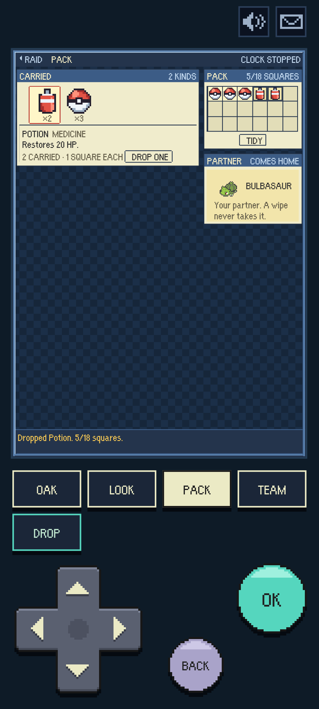
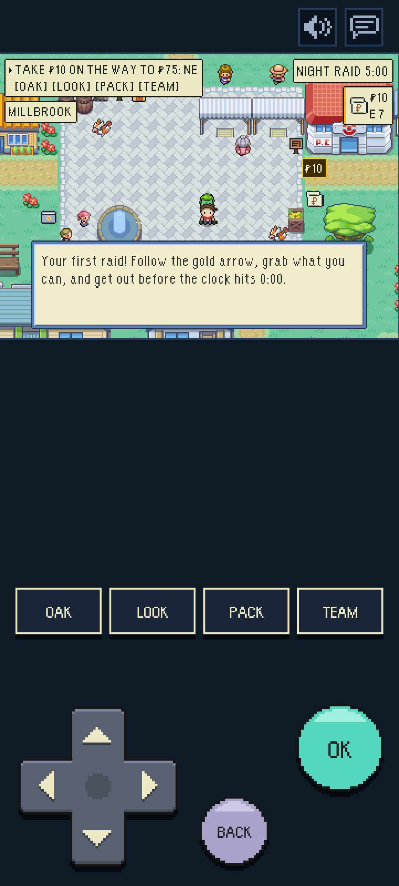
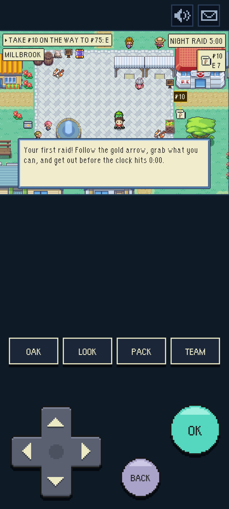
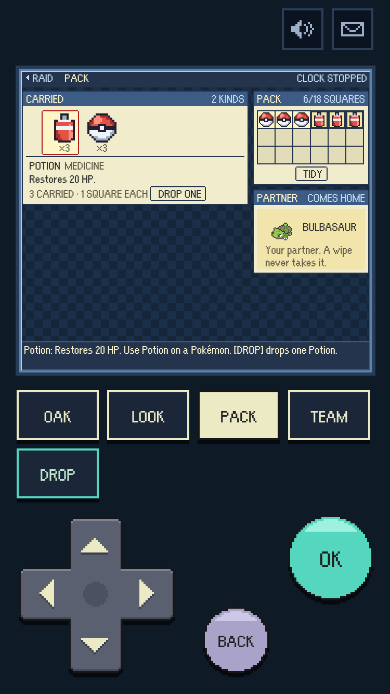

# The tray's keys stay where a thumb learned them

A fresh critic of the phone game found that a key moved when a screen added
one of its own: on a phone on its side, opening the pack and getting its DROP
key sent PACK across to the other thumb, and upright the row of four became
three and two. Now the scene's own keys keep fixed places and a key a screen
or a moment adds (DROP, DECORATE) comes after them, framed teal. Also: the key
whose screen is open is lit on a phone on its side too; the pack's "X drops one
Potion." says "[DROP] drops one Potion."; the raid's chip no longer repeats
"[OAK] [LOOK] [PACK] [TEAM]" over a tray that shows them; FEEDBACK is a
letter, not a speech bubble beside SAY; BACK stands clear of the d-pad.

| | before | after |
|---|---|---|
| pack, on its side |  |  |
| pack, upright |  |  |
| raid |  |  |
| pack, small phone | |  |

Made with `node tools/playtest/phoneTour.mjs <test-mode build url> <dir> --device=...`.
