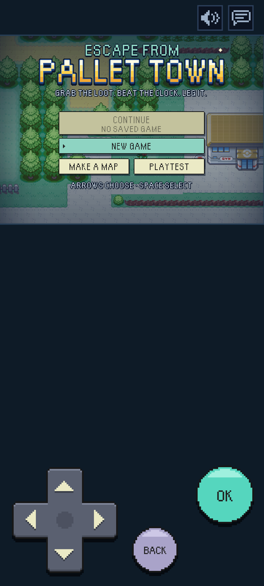
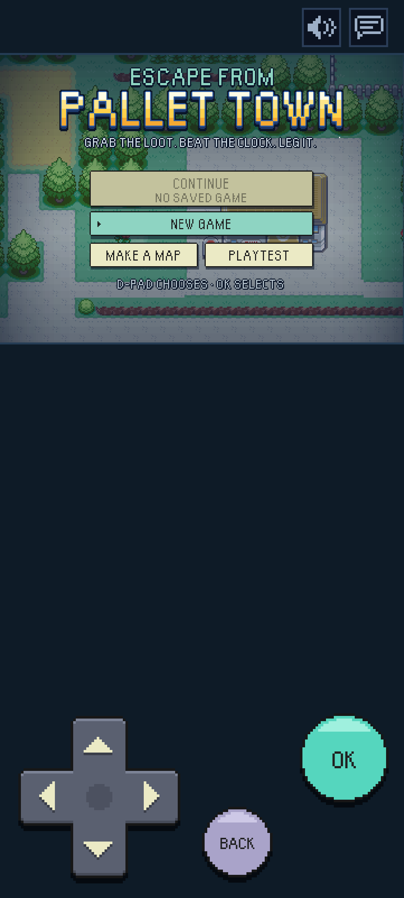
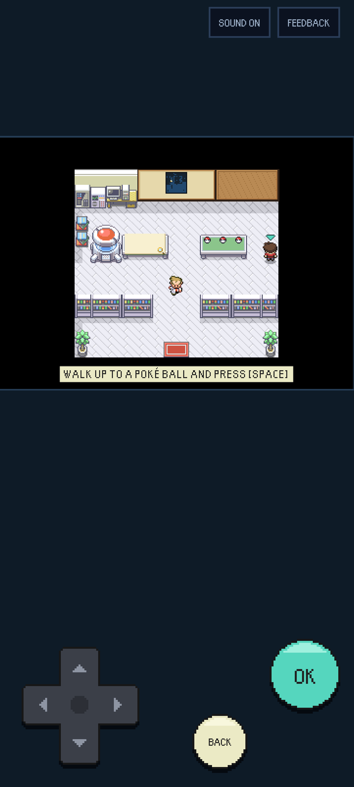
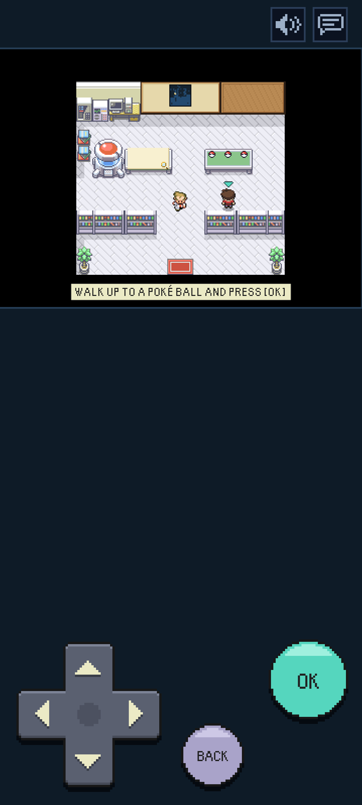
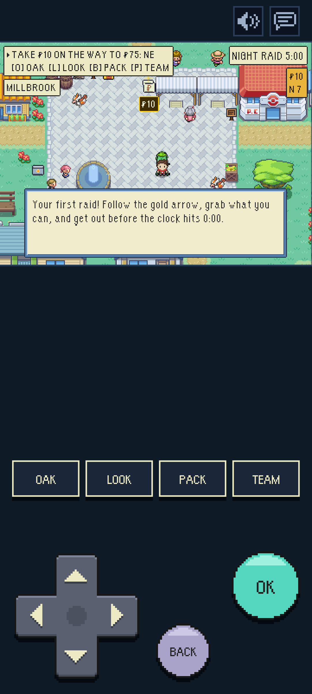
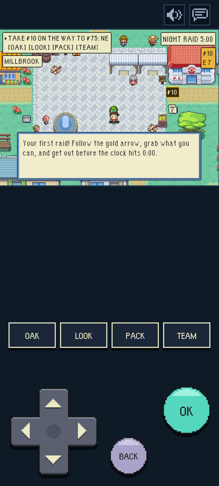

# Hints name the touch pad's buttons

On the touch pad, a hint that said "[SPACE]" or "[B] PACK" taught a key the
thumb cannot press. Now, while the pad is up, every word the game draws says
its keys the pad's way: SPACE and ENTER are OK, ESC is BACK, the arrows are the
D-PAD, and "[B] PACK" is "[PACK]", the word on the tray's button.

| | before | after |
|---|---|---|
| title |  |  |
| Oak's lab |  |  |
| first raid |  |  |

Made with `tools/playtest/phoneTour.mjs` and `phone.mjs` at `--device=portrait`
against a `VITE_EPTW_TEST_MODE=1` build at `?testmode=pixels`. (The dialogue box's
new colours in the raid pictures are #800, which landed between the two.)
