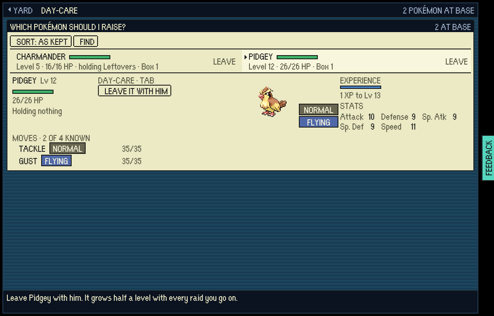
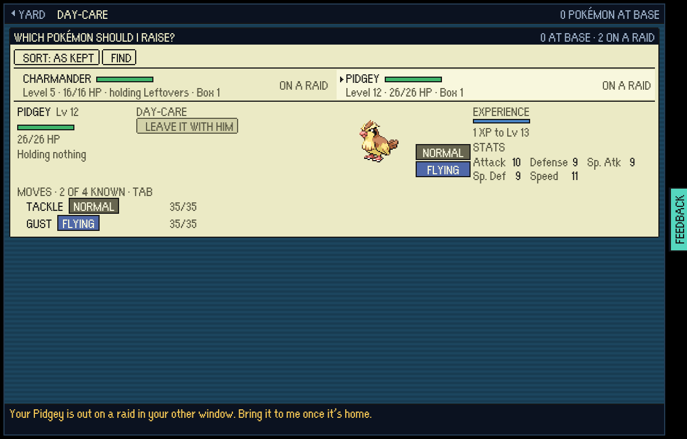
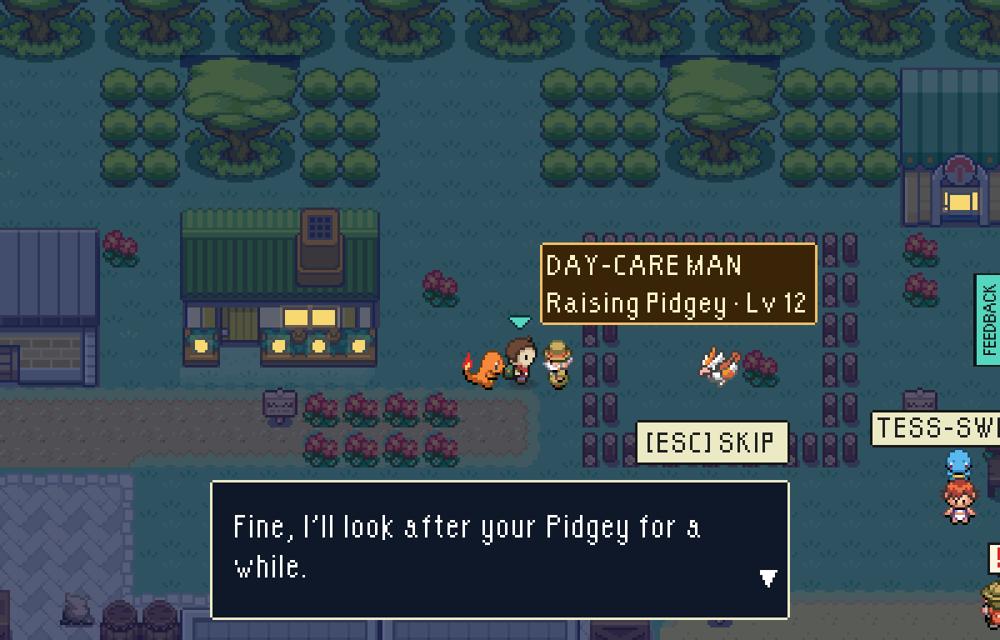
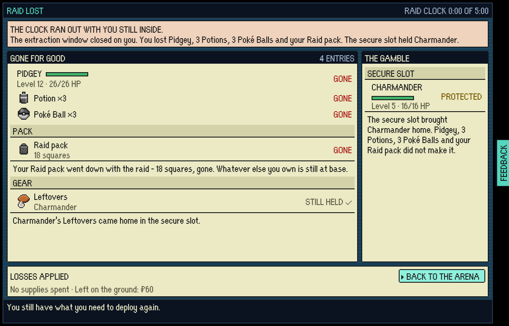
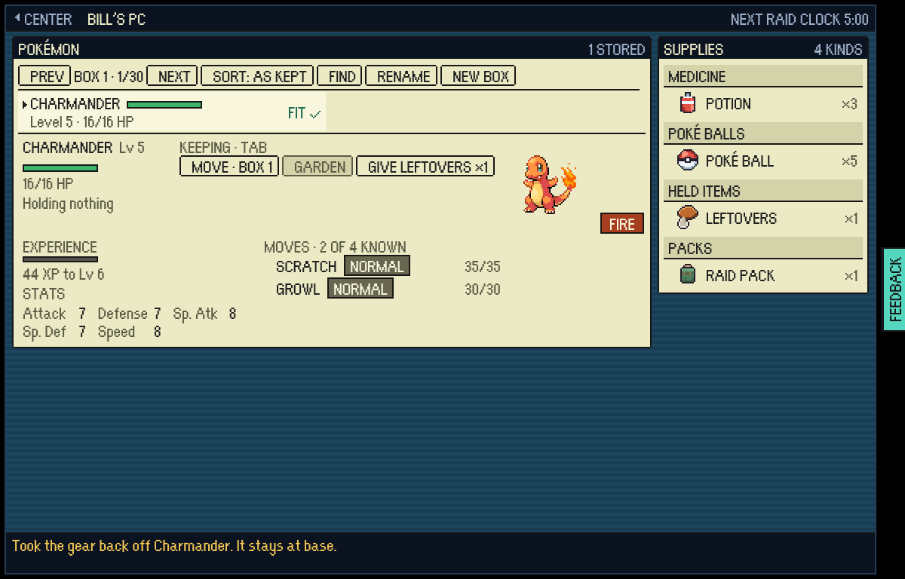
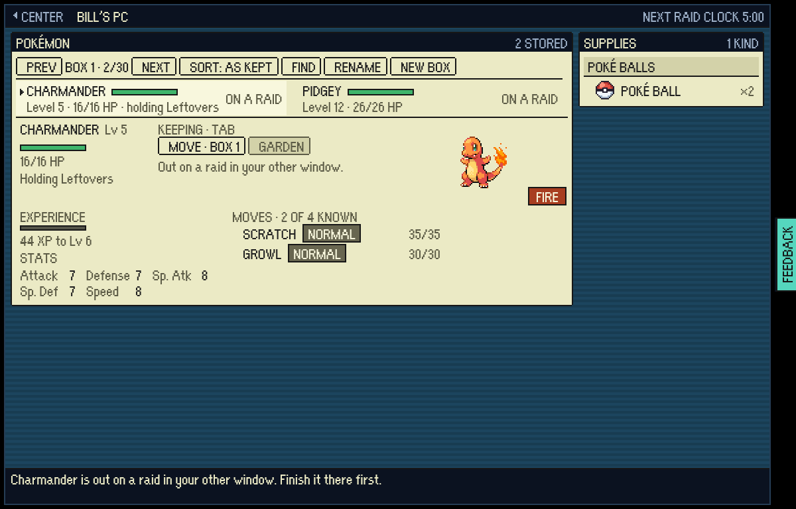
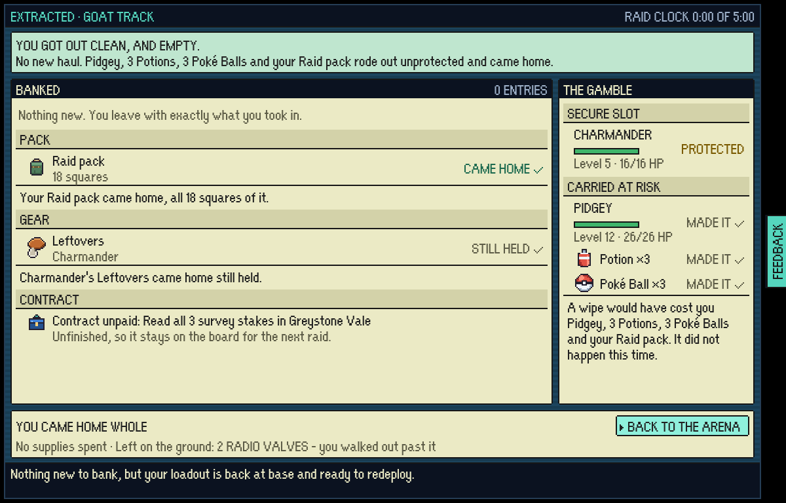
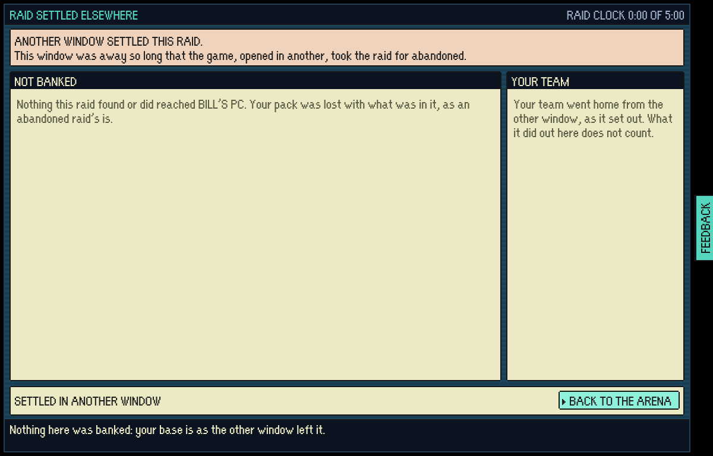

# Two tabs, one raid

The 9 Nov bug hunts (battles, saves, raids, harbour, vale) all found the same
root cause from different sides: two tabs share one save, and the base in a
second tab could change a Pokémon that was out on a raid in the first. The
raid's ending then wrote its own copy of that Pokémon back over the vault.

Made by `tools/playtest/twoTabRaid.mjs` against two test-mode builds
(`VITE_EPTW_TEST_MODE=pixels npx vite build`), each served under the Pages
subpath by a plain static server, in one headless Chromium at 1200x768. The
`before-*` pictures are `main` at `1582d5b7` (run with `--before`). The
`after-*` pictures are this branch. The `*-frozen-*` pictures are the same
driver with `--frozen`. A plain (non-test-mode) build of the branch passed the
same run at real speed.

## The Day-Care and the wipe

Tab A takes Charmander (holding Leftovers) and a Pidgey Lv 12 on a raid. Tab B
opens the same save and walks up to the DAY-CARE man.

| Before | After |
|---|---|
|  He offers to take the Pidgey that is out. |  Both rows say ON A RAID, the count says 0 AT BASE · 2 ON A RAID, and he refuses. |
|  He takes it. | |
|  Tab A runs out of clock. The screen says Pidgey is GONE, but the save still has it at the Day-Care. |  The same screen, and now it is true: the save has no Pidgey. |

## BILL'S PC and the gear

| Before | After |
|---|---|
|  Tab B takes the Leftovers off the Charmander that is out. After the wipe the save holds two Leftovers. |  The rows say ON A RAID, the pane offers no gear, and SUPPLIES counts only what was not packed (the three Potions and three of the five Poké Balls are in the pack). After the wipe the save holds one Leftovers. |

## A frozen tab whose raid was settled elsewhere

Tab A is frozen mid-raid; tab B opens the game, and the base settles the raid as
abandoned (the pack is lost). Tab A then wakes and walks out.

| Before | After |
|---|---|
|  "Your Raid pack came home", but the save has no Raid pack. A raid tab B had deployed since would also have had its in-flight mark cleared. |  The screen says another window settled the raid, and nothing is written. |
