# Millbrook and the first two rings, walked

A focused test of what #419 and #423 filled in, at the real 3x window, on the explorer
run (so the corner chip says PLAYTEST). Every shot is the game itself.

| | Before | After |
|---|---|---|
| A man standing on the pond, past the end of the jetty's short plank, which a player could walk out on too (the harbour's angler and a regular as well) | 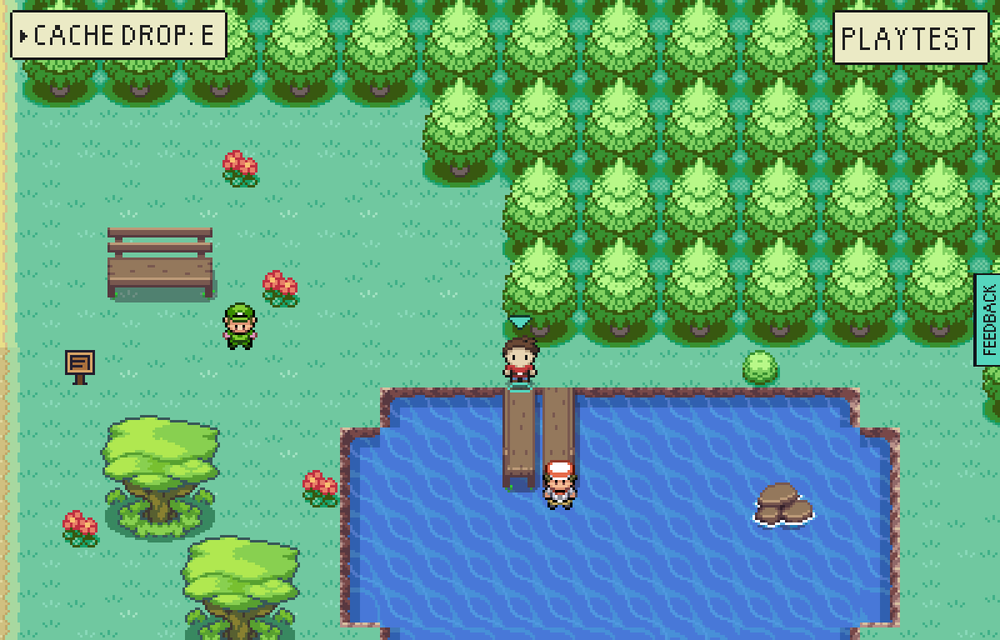 |  |
| A berry tree growing out of Duck Island's deck | 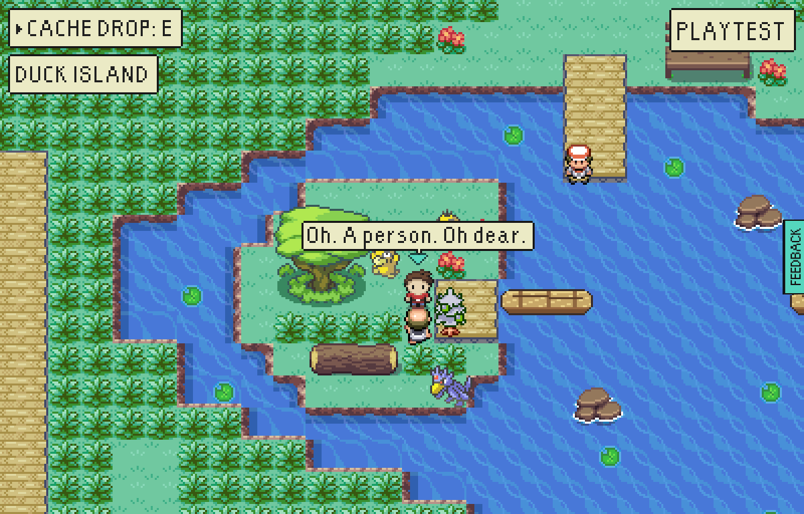 | 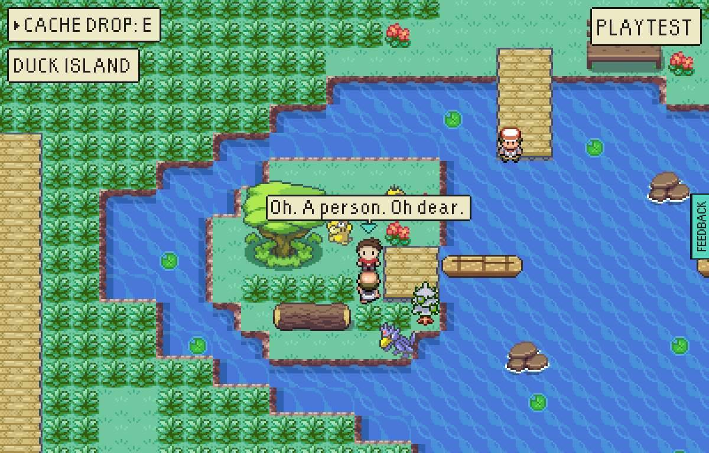 |
| Surf breaking along the foot of the cliff and round the wood, on dry land | 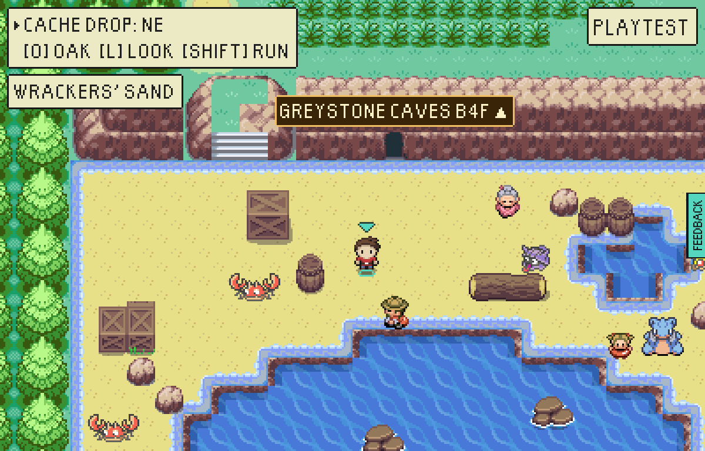 | 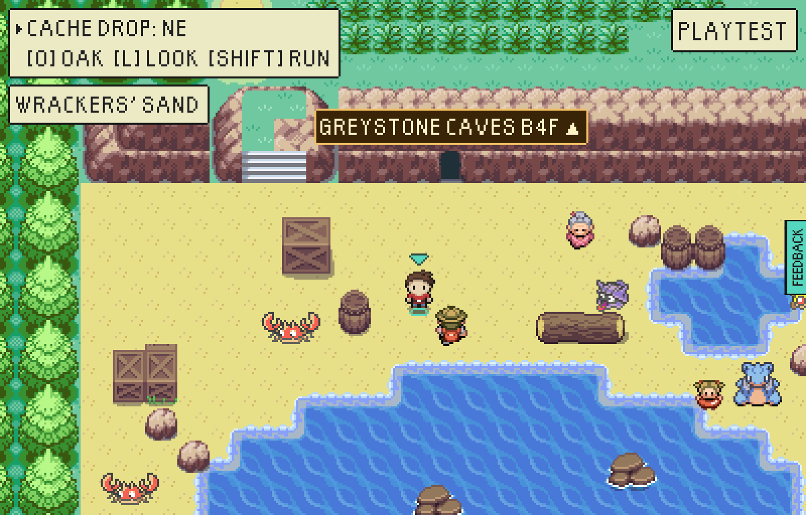 |
| A rock too shallow for its own top, by Moor Top | 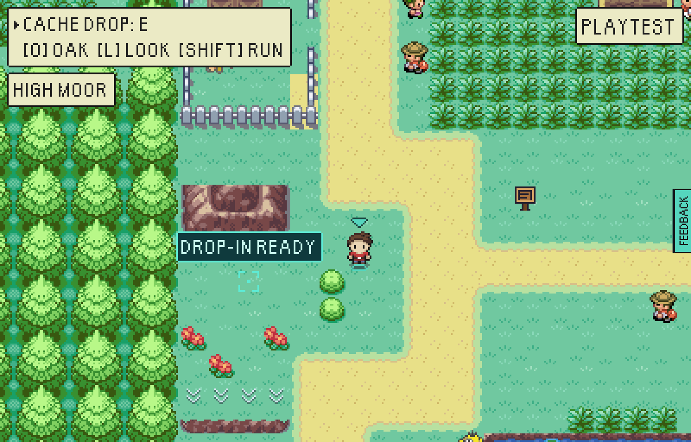 | 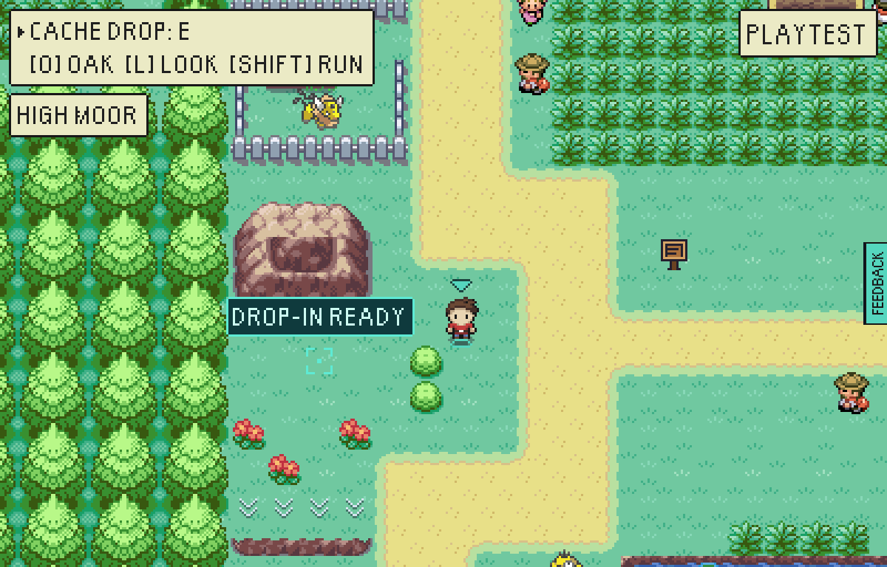 |
| The drovers' fold standing in stripes of sand from the road beside it | 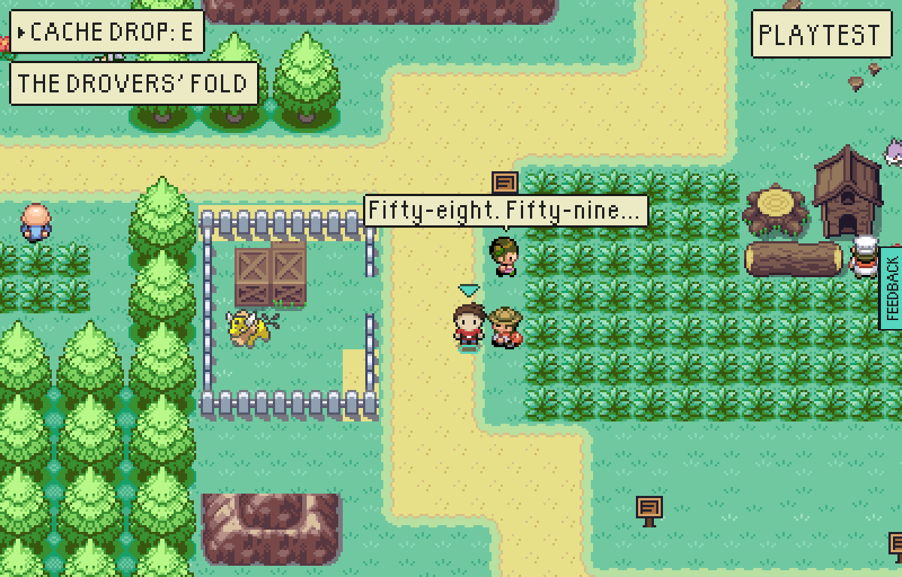 | 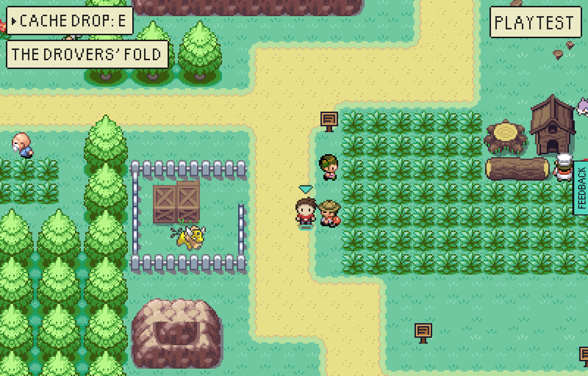 |
| A ruled line across the road where a street turns to sand | 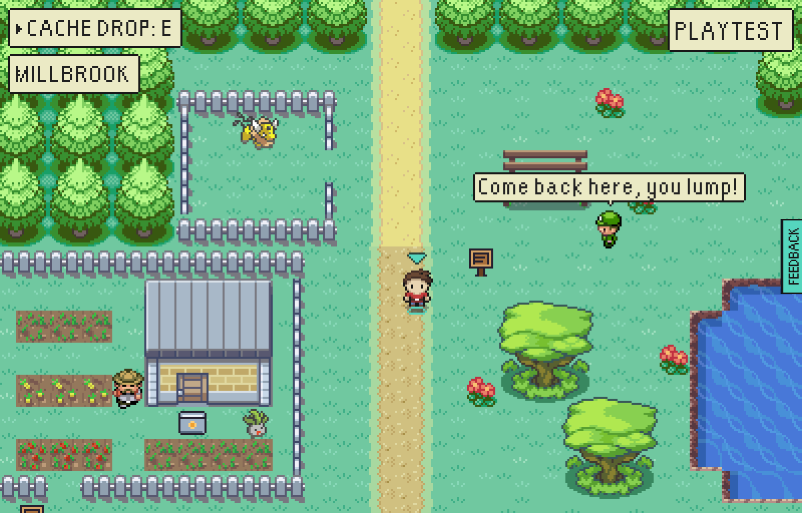 | 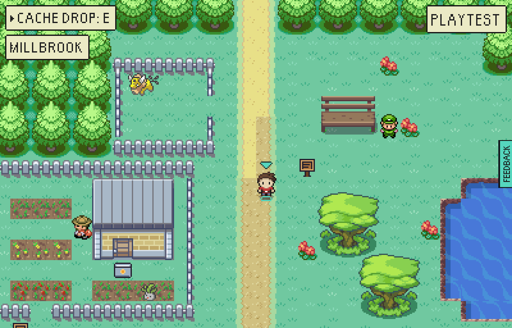 |

By night nothing is drawn differently but the clock's chip, and the walk comes out the same:
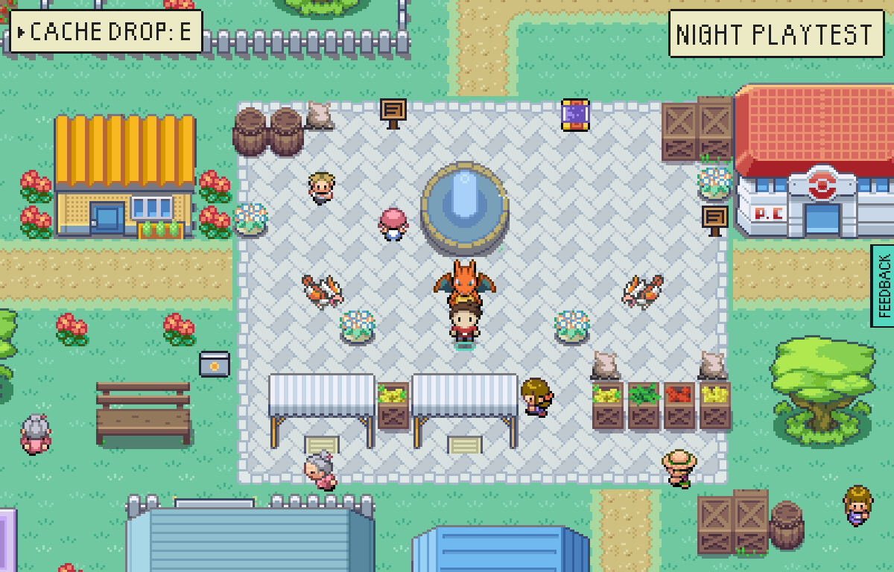 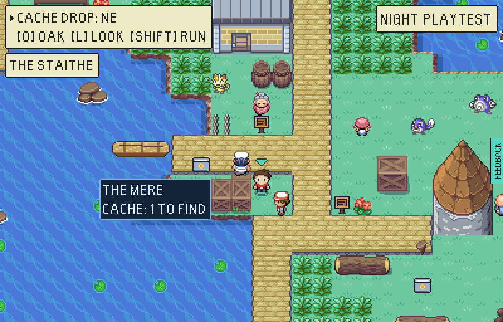

Also fixed, with nothing to see: High Moor's hunter had a loop corner under a Nidoran and
another behind the Lost Fold's boulder, so it never went north of the ledges; and a Gull
Strand sign sent you west over a bridge that is east of it.

Left alone: where a four-wide ridge meets a wider spur in the Peaks' gorge the rock's top
ends in a square corner. `catalogue.ts` says why (a mound that is not a rectangle has no
inside corner in FireRed's art), and it is older than these rings.
