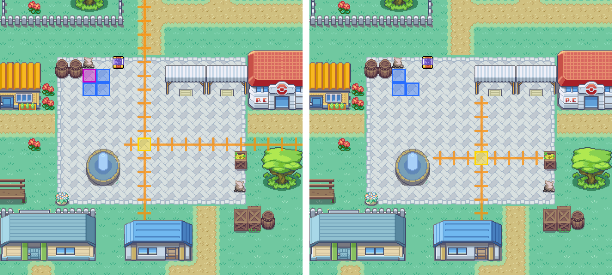
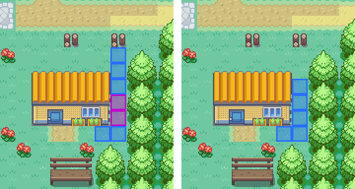
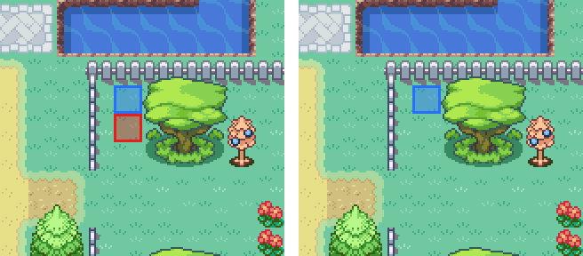
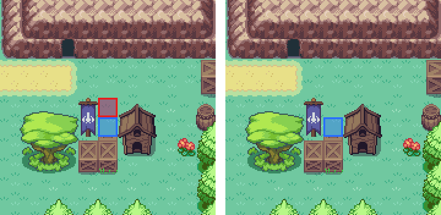
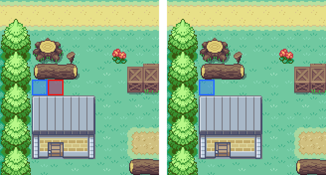
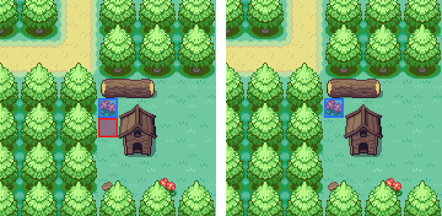

# The vale's structure rules, green again

`mapStructure.greystoneVale1.test.ts` was red on `main` from #503 (Millbrook made
walkable) and stayed red through #511 (Tanglewood). These pictures show what it
saw, before on the left and after on the right.

How they were made: `tools/mapcraft/world.mts` was run on `main`'s district
programs to write each district as the game draws it (no figures are drawn
there), and `node docs/screens/vale-structure-fixes/draw.mjs <out-base>` crops
those pictures and marks them. The art is the same before and after - nothing
here moved a prop - so one district picture serves both sides.

| Mark | Means |
| --- | --- |
| Yellow square | where a new game lands |
| Orange ticks | holding one direction from the landing, until something stops you |
| Blue squares | every tile of a figure's beat (the rules count each one as a wall) |
| Red square | a beat tile that is a nook's only door |
| Magenta square | ground sealed off between beats, that nobody can reach |

## Mill Square

The landing stood on the crossing, so holding up ran 49 tiles up the north
street and holding right ran 17 along the east one, where the rule is a wall
within four steps every way. It now stands in the corner beside the crossing:
the stall is 4 steps up, the fountain 3 to the west, the crate 4 to the east and
the square's edge 4 down. The streets are as #503 drew them, straight and two
wide. The square's Pidgey walked an L round a tile beside the notice board; it
now pecks on that tile instead of sealing it.

## The flower house's alley

The Butterfree flitted up the one-tile alley and Mrs Lark walked across its foot,
sealing the two tiles between. The Butterfree now flits down to her.

## The orchard's Caterpie

It roamed one step out of a one-tile nook between the fence and a tree, and
standing there it was the nook's door. It now keeps to the far end and glances.

## Tanglewood's nooks

The same fault three times over: each roamed a tile out of a one-tile nook, so
each stood in its door. Each now stands at the nook's far end and glances.
