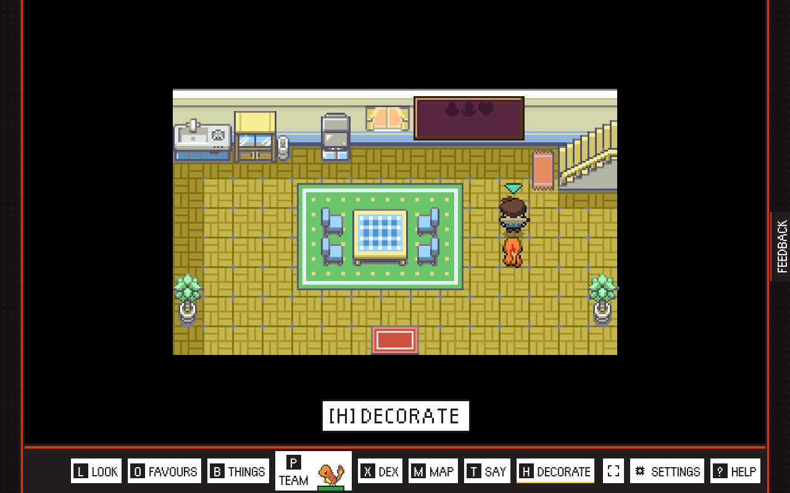
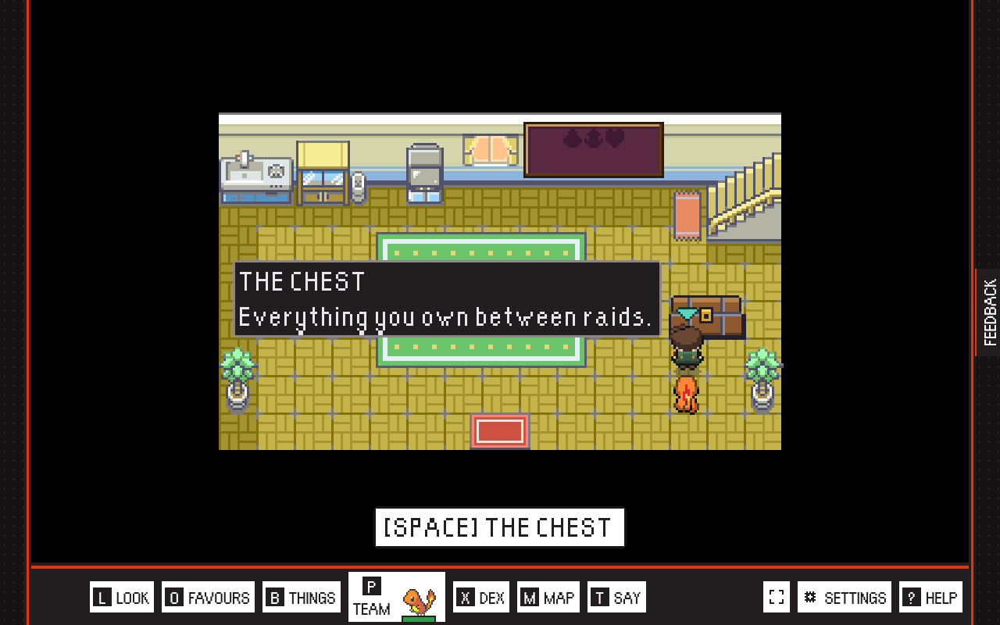
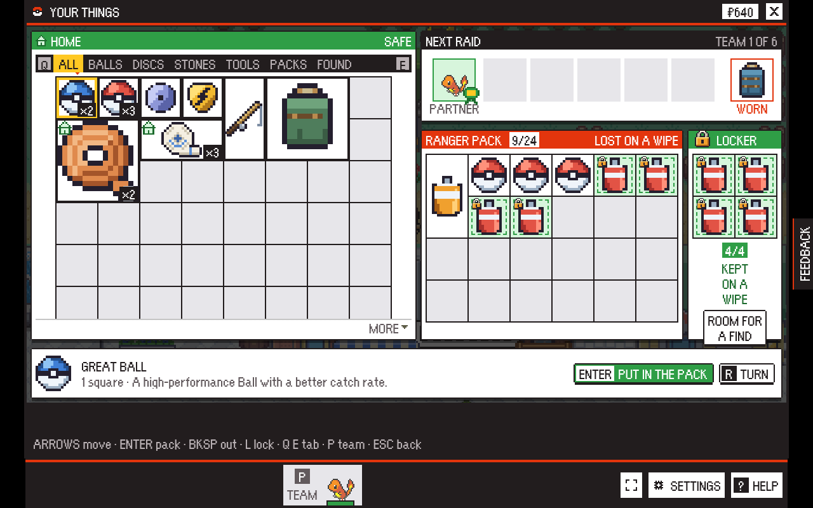
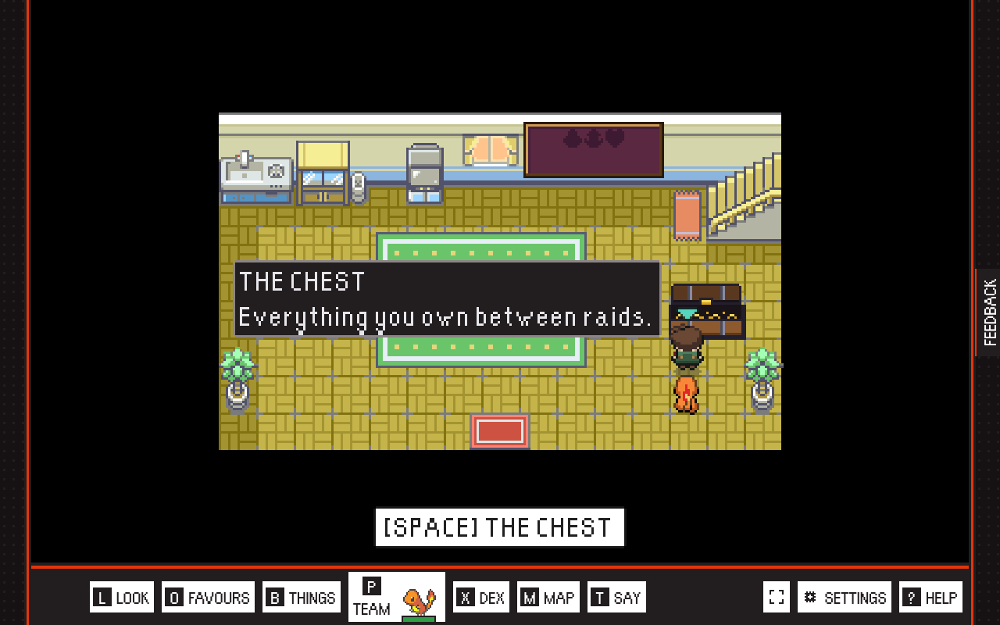
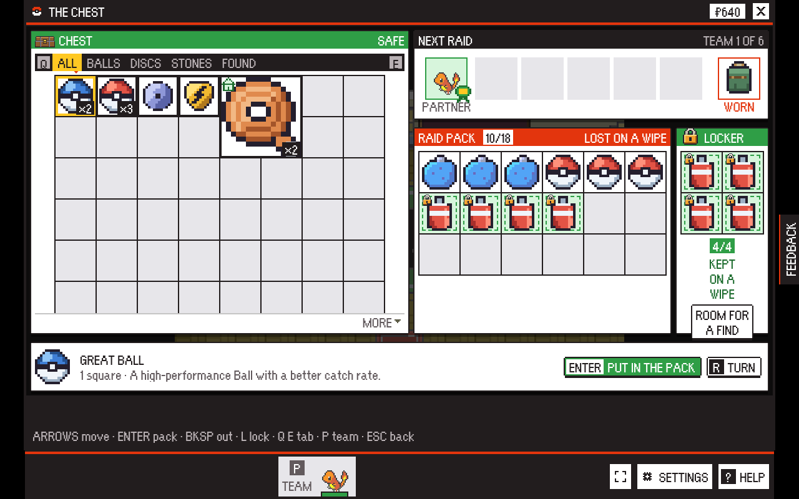
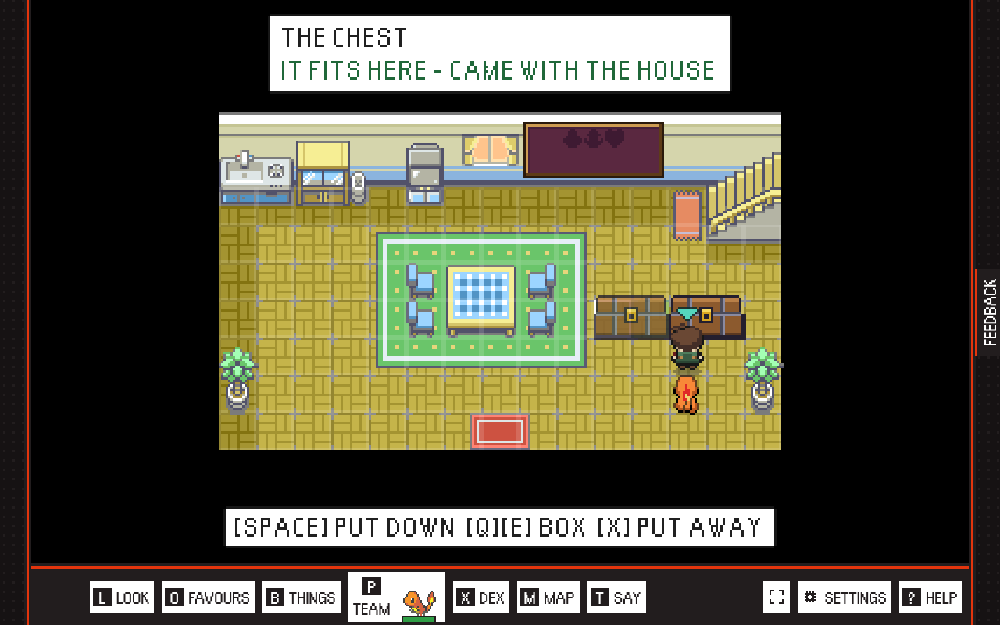
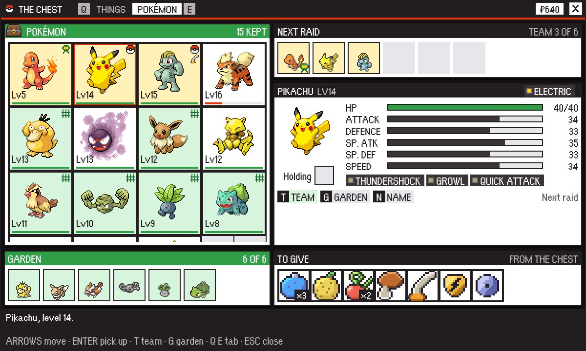
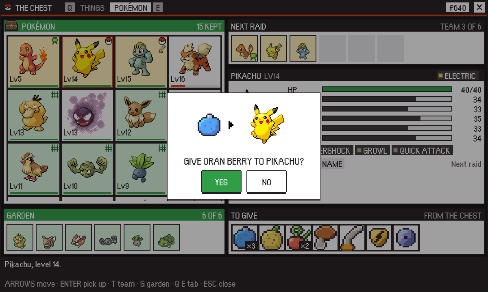

# THE CHEST (vault makeover, part 1)

The captain, 26 Nov 2026: "your vault should be your storage chest in your
house, in your Bolthole". He saw a mock-up of the whole makeover, liked the
chest, and asked for it three tiles down and one east of where the mock-up
stood it, and movable like any other furniture.

| Before | After |
|---|---|
|  The front room had nowhere you kept anything. |  THE CHEST stands by the stairs, named on the hint line. |
|  YOUR THINGS called storage HOME. |  SPACE throws the lid back... |
|  Your things were found at BILL'S PC, at the Center. |  ...and the same grid opens, headed THE CHEST, its storage headed CHEST. |

-  B anywhere still opens it, as YOUR THINGS.
-  Decorating (H) picks it up like any piece...
-  ...and puts it down where you like.
-  X never puts it in the box: THE CHEST STAYS OUT.

The next parts, from the same mock-up: a POKéMON tab in the chest with every
Pokémon in one grid, no boxes (), things dragged onto a
Pokémon with one question (), and BILL'S PC sending
the player home.

Made with `node tools/playtest/chest.mjs <test-mode build url>/?testmode=pixels <dir> --window=1280x800`
against a `VITE_EPTW_TEST_MODE=1` build (`tools/playtest/README.md`, "Memory").
The before pictures are the same build of `main` at 8ba3ce0e.
