# THE HARBOUR, walkable

The captain, 11 November 2026: "I really like the idea of what you've built,
but ... when you're walking around, there's just often things in your way, and
it's quite fiddly to get through places. For instance, like in the harbour, when
you walk directly to the east, in between it going from gravel to stone or
whatever, there's just a bench right in the middle, or like when you go on the
beach, you kind of just get all caught up in the parasols." Millbrook was fixed
first (`docs/screens/walkable-millbrook/`); this is the second area: THE HARBOUR
and its beach. Nothing outside the harbour was touched.

Everything that made it rich is still there - every building, sign, crate,
barrel, post, lamp, hut, parasol, deckchair, person and Pokémon - moved off the
walking lines rather than taken away.

## What was in the way, and what moved

Walked in the game by `tools/playtest/walkableVillage.mjs --area=harbour`: 23
routes from where a visit starts and from the jetty a raid comes home to, and
back (`snags-before.json`, `snags-after.json`). **78 snags before;
none after, and every route arrives.** Walked two abreast over the map (`harbourWalkable.test.ts`),
the old harbour was four places a pair could not walk between: the yard, the
quay, THE PROMENADE and THE COVE.

| Snag (before) | What it was | Now |
|---|---|---|
| The bench | Walking straight east from the end of KEEPERS' ROW's gravel to THE PROMENADE's stone, the bench stood across the way, the Safari Warden beside it | The bench is on the lawn's edge above THE COVE, looking out over the water; the way east is clear, two rows wide |
| The Day-Care's fence | The pen's bottom fence stood across the same straight row | The pen is a row shallower (three rows of grass, not four), so row 13 runs straight from the spawn to the end of the stone |
| Pidgey on the stone walk | Its beat stepped onto the walk's first tile | Under the fountain, between the ways up either side of it |
| The parasols, deckchairs, THE DIG and a Krabby | On the sand in front of the huts, they left one row along the water, and THE DIG's sign stood at the foot of the first steps and a Krabby at the foot of the second | The huts back onto the boardwalk's railing, so the sand in front of them holds the parasols, deckchairs and THE DIG in a row, beside the steps rather than under them; the two rows along the water are clear from THE COVE to the pleasure pier |
| The lamps | Each stood on both rows of the boardwalk, so the boardwalk was blocked every six tiles | A lamp stands on its post in the railing (`promenadePost`), its head drawn over the boardwalk behind it |
| The barrels and a post by the quay | The way down from the yard to the boat was a tile wide, and so was the quay from the jetty to the square | The quay is clear two rows wide from the jetty to the warehouses; the barrels and posts stand at the foot of the long pier, Bill's crates against his cottage |
| The cellar doors, the crate stack | Along the quay's top they made the square-to-quay crossing a row of one-tile gaps | The strongroom and second locker stand in HARBOUR SQUARE's paving either side of the fountain |
| The dock worker, his Machop, a post and Meowth | On the two rows along the warehouses' front, the one way along the water to THE COVE | The warehouses stand a row back from the water: the dock worker and his Machop work the row along the wall, the two along the water are clear, Meowth sits by the crates |
| The Raid Arena's sign | In the one-tile gap between the yard and the Arena's forecourt - the door every raid goes through | On the forecourt under the Arena's colours, with the Gym Guide beside it |
| THE BOLTHOLE's sign | On KEEPERS' ROW | Against the house's west side, read from the row |
| THE GREEN's and THE PROMENADE's signs | At the foot of the ways up to THE HARBOUR BOUTIQUE and THE GREAT LIBRARY | Beside them |
| The arcade boy, a trough and a pennant | In front of THE FIELD-MOVE COURSE's gate | The troughs either side of THE GAME CORNER's plaza, the boy against its wall, the pennant by the trees |
| The Krabby, the girl and the Psyduck in THE COVE | On the way along the sand | Along the water's edge |
| The clearing behind the keepers | What Brock builds there was read from a lane one tile wide | The clearing is a row deeper |

Also: a regular arriving through a door no longer arrives into it while another
stands knocking on its step (`planVisit` in `harbourActivities.ts`), which had
left them standing in the doorway until they were drawn across the harbour.

## Held by a test

`src/game/base/harbourWalkable.test.ts`: a 2x2 walker - a street's width - goes
from the spawn and from the landing, with nothing built and with everything
built, by day and by night, with every person and Pokémon on every tile of their
beat, and must reach every door's step, sign, landmark, fixture and person; no
door may be further two abreast than single file; nothing may stand on KEEPERS'
ROW; and four ways are held clear by name: row 13 from the spawn to the end of
the stone (and row 14 beside it from the end of the gravel), the boardwalk, the
beach's two rows along the water, and the foot of every set of steps. Against
the old harbour it names nearly every door, sign and person in it.

## Pictures

| Before | After |
|---|---|
| 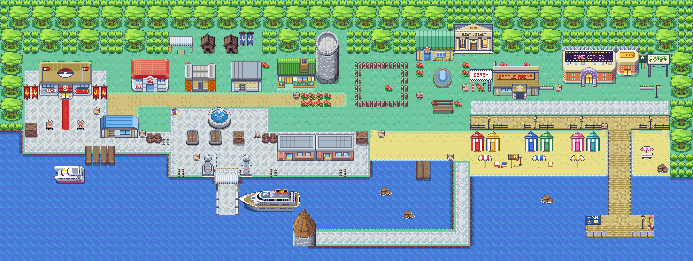 | 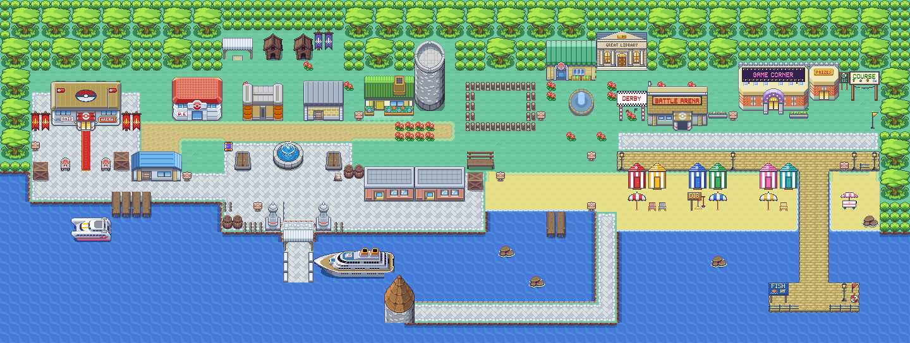 |
| 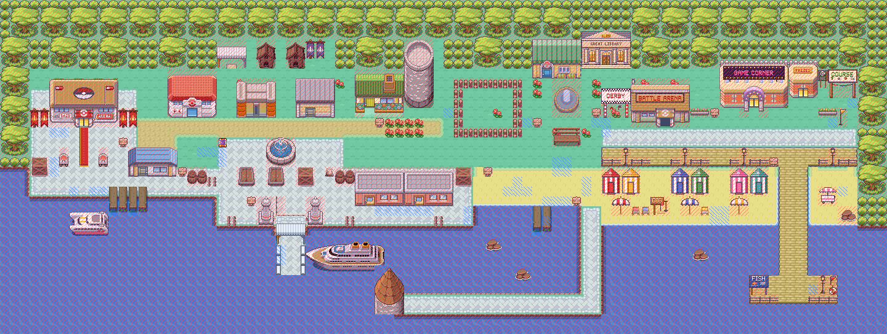 | 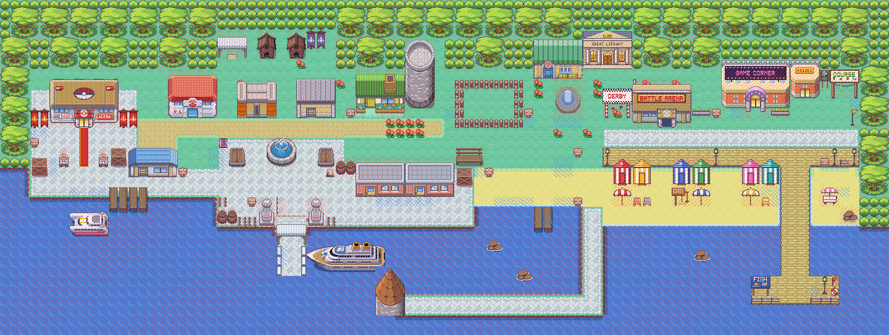 |
| 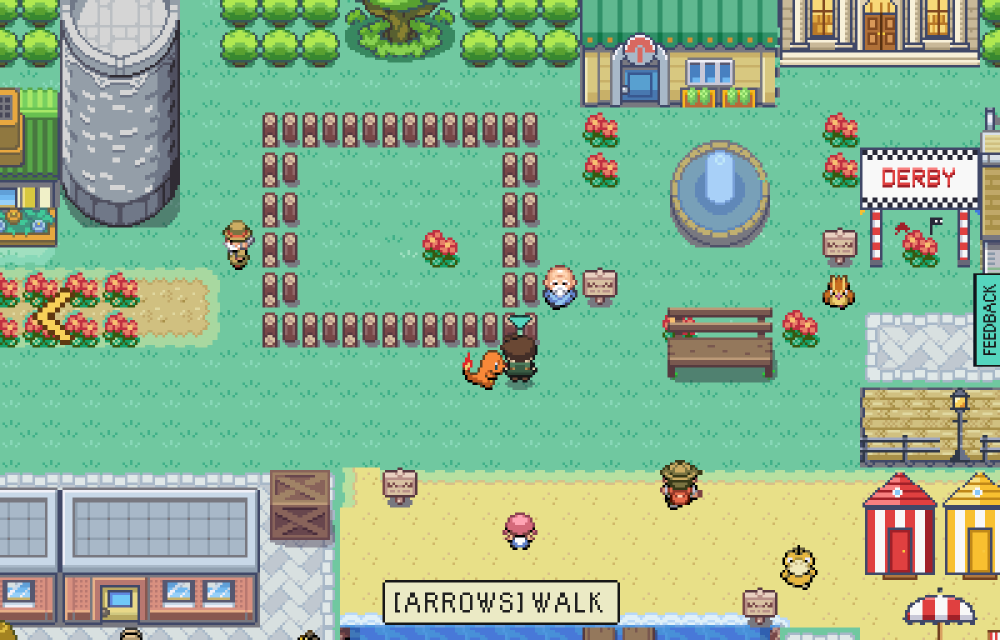 | 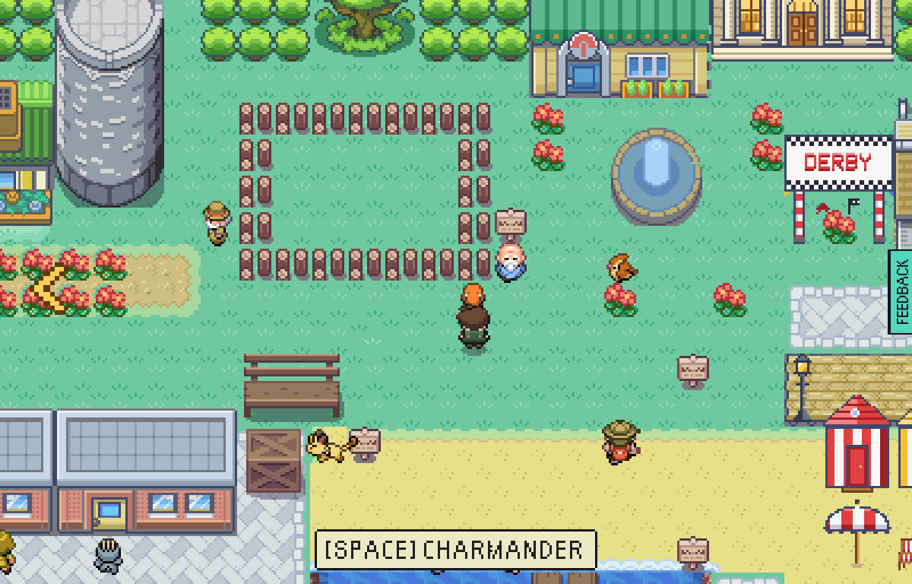 |
| 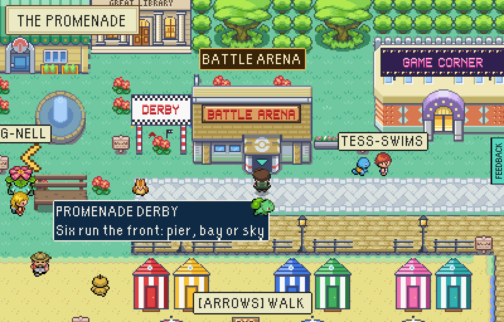 | 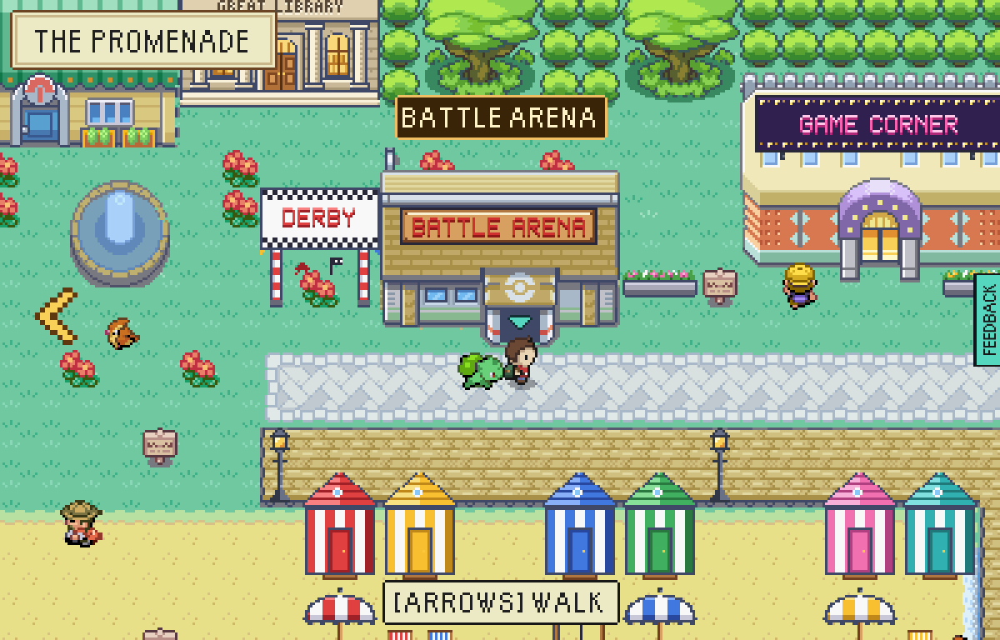 |
| 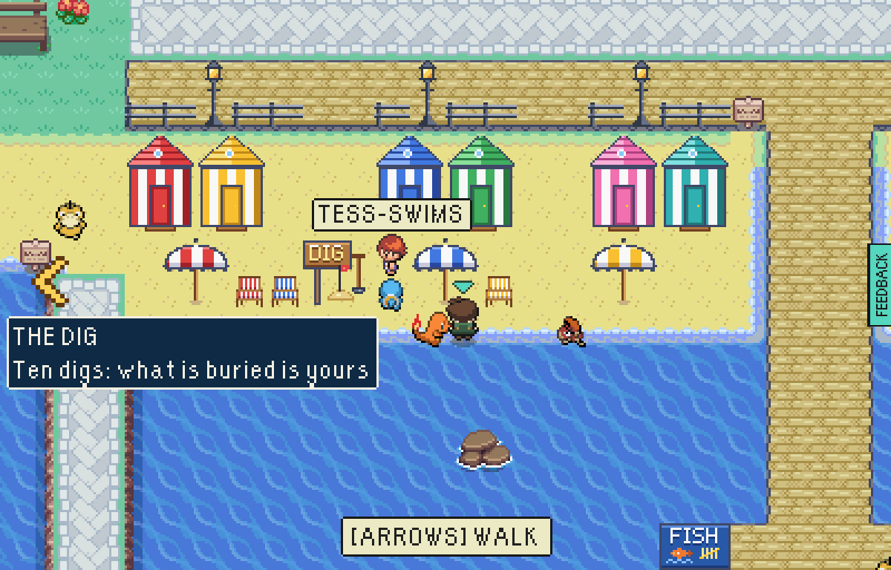 | 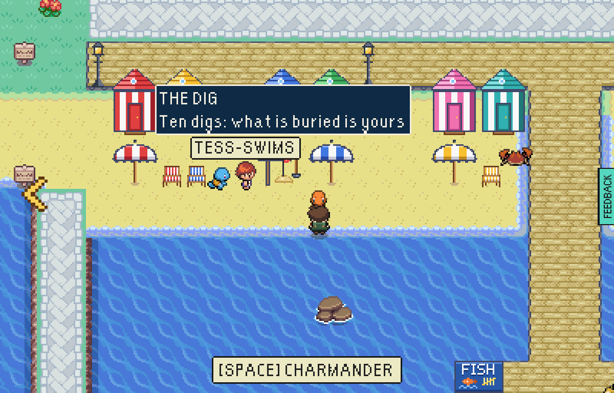 |
| 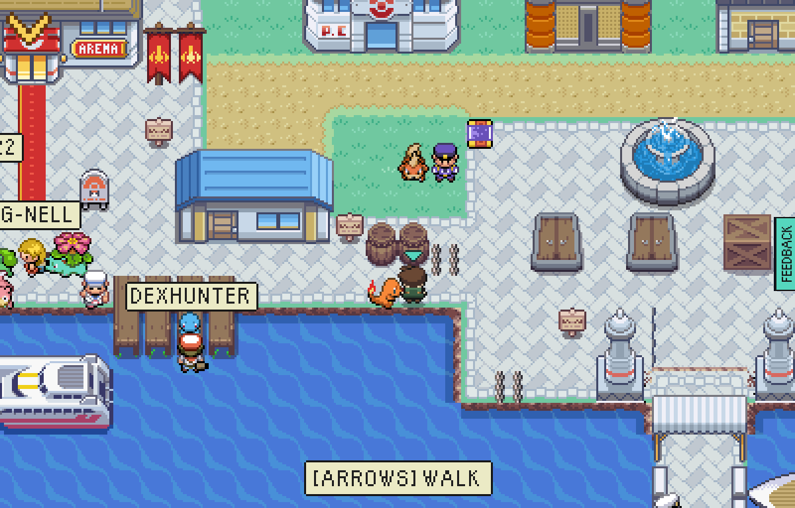 | 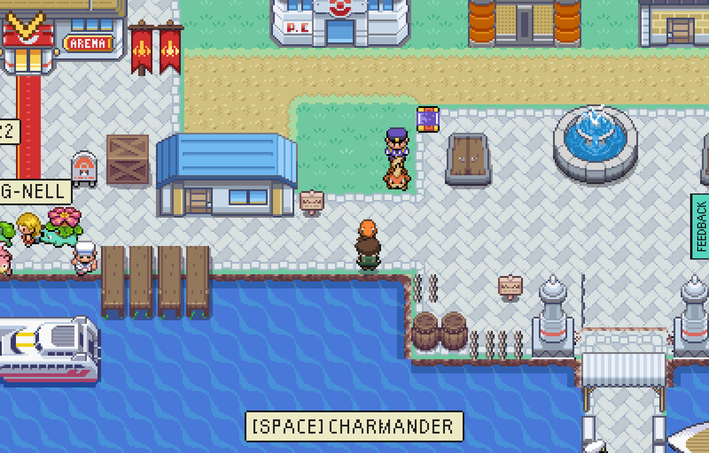 |
| 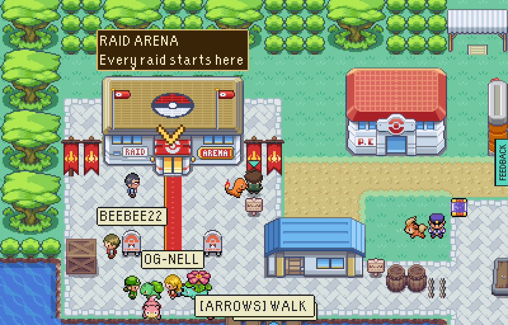 | 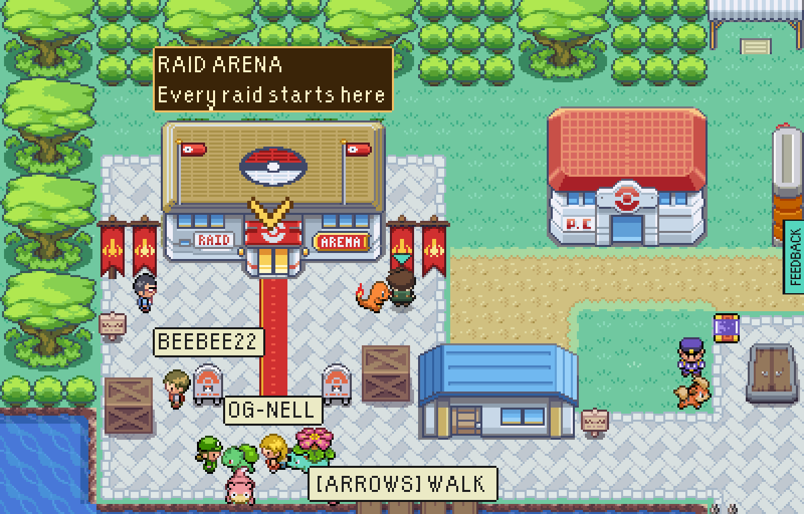 |

In the collision pictures, red is solid and blue is a person's or a Pokémon's
beat.

## How they were made

- The whole-harbour pictures are `npx vite-node tools/base/renderBase.mts --
  <out> 1 --built=all`, on `main` before this change and after it; the collision
  ones add `--collision --beats`.
- The in-game pictures are `harbourTour.mjs --built=all --clock=day
  --at=beach:70:22,green:52:14,quay:20:19,forecourt:12:13` (the promenade pair is
  where `walkableVillage.mjs`'s route to the Battle Arena ends), and the snag lists
  are `walkableVillage.mjs --area=harbour`, both against two test-mode builds (`VITE_EPTW_TEST_MODE=1 npx vite build`), one from
  before this change and one after, served under `/escape-from-pallet-town-web/`
  and driven in headless Chromium at `PIXEL_WINDOW`, by day.
