# Millbrook, walkable

The captain, 11 November 2026, of the vale after it was filled: "I really like
the idea of what you've built, but ... when you're walking around, there's just
often things in your way, and it's quite fiddly to get through places." He gave
the harbour's bench and the beach's parasols as examples, and asked for one area
fixed first: the first village a new game drops into. That is **Millbrook**, the
landing on Mill Square (`greystone-vale` in `RUN_INSERTIONS`, the vale's front
door). Nothing outside Millbrook was touched.

Everything that made it rich is still there - every person, Pokémon, sign,
berry tree, find, house, stall and door - moved off the walking lines rather than
taken away.

## What was in the way, and what moved

Walked in the game by `tools/playtest/walkableVillage.mjs`: 13 routes from the
landing and back (`snags-before.json`, `snags-after.json`). **51 snags and three
routes that never arrived, before; none after.**

| Snag (before) | What it was | Now |
|---|---|---|
| Landing boxed in | You landed between the fountain (above) and a market stall (below), with planters either side and two Pidgey walking the one clear row | The square's crossing is kept clear: the streets run straight across it two abreast, and the market stands in its quarters |
| Fountain at the end of the north street | Coming down from the moor you walked straight into it | The fountain stands in the square's south-west quarter, with the children racing round it |
| One-tile way out of the square to the south | Between the Trader, a stall and the sacks | Open from the landing to the south street; the stalls' keepers stand on the lawn behind their stalls |
| Pidgey on the through-row | Walking across the square, a Pidgey stepped into your line | Pidgey beat in the quarters, off the lines |
| Stallholder on the south street's mouth | Her beat stepped into it | Behind her stall |
| Gatekeeper on his own doorstep | His cottage door could not be reached at all | He stands by the gate posts, off the road |
| A tree straight inside the orchard gate | The gate opened onto a trunk | The gate is a row lower, where the first row is clear |
| A one-tile alley between the blue house and the cottage | A shortcut from the square to the south street, one tile wide | Two wide (the blue house stands a tile west) |
| The lane south bent round a copse in its line | Walked straight, you met trees | The lane runs straight, the glade opening off it |
| A log one tile from the woodshed | The way to its door was one tile wide | The log pile stands back |
| Tom, Mrs Lark and the butterfree in the only ways round | The pool's west path, and the flower house's sides | Moved to the edges |
| Three one-tile garden gates, a one-tile pound gate | Squeezing in | Two wide |
| The MILLBROOK sign in Old Row's mouth | Narrowed the street to one tile where it meets the road | Beside it |
| Fern between the washing green's gate and its berry tree | Every way to the tree went round her | The green is a row up, gated onto Old Row, with the keepers' lawn below it |

## Held by a test

`tools/mapcraft/worlds/greystoneVale/millbrook.test.ts`, "Millbrook, walked two
abreast": a 2x2 walker - a street's width - goes from the landing over the
stitched map's collision, with every figure standing on every tile of its beat,
and must reach every way out, door, sign, landmark, berry tree, person and find
to within the one last step a porch or an exit's pocket is; no way out or door
may be further two abreast than single file; and nothing may stand on a street.
Narrow on purpose, and listed there: Old Wick's jetty, the stepping stones to the
island, and Hazel's garden behind the Cut tree. Against the old village it names
every way out, every door and nearly everyone in it.

## Pictures

| Before | After |
|---|---|
| 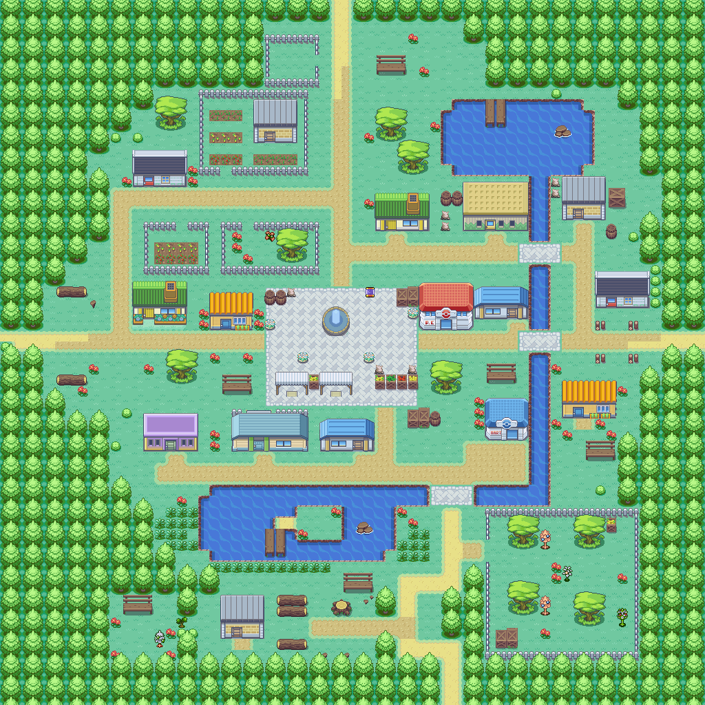 | 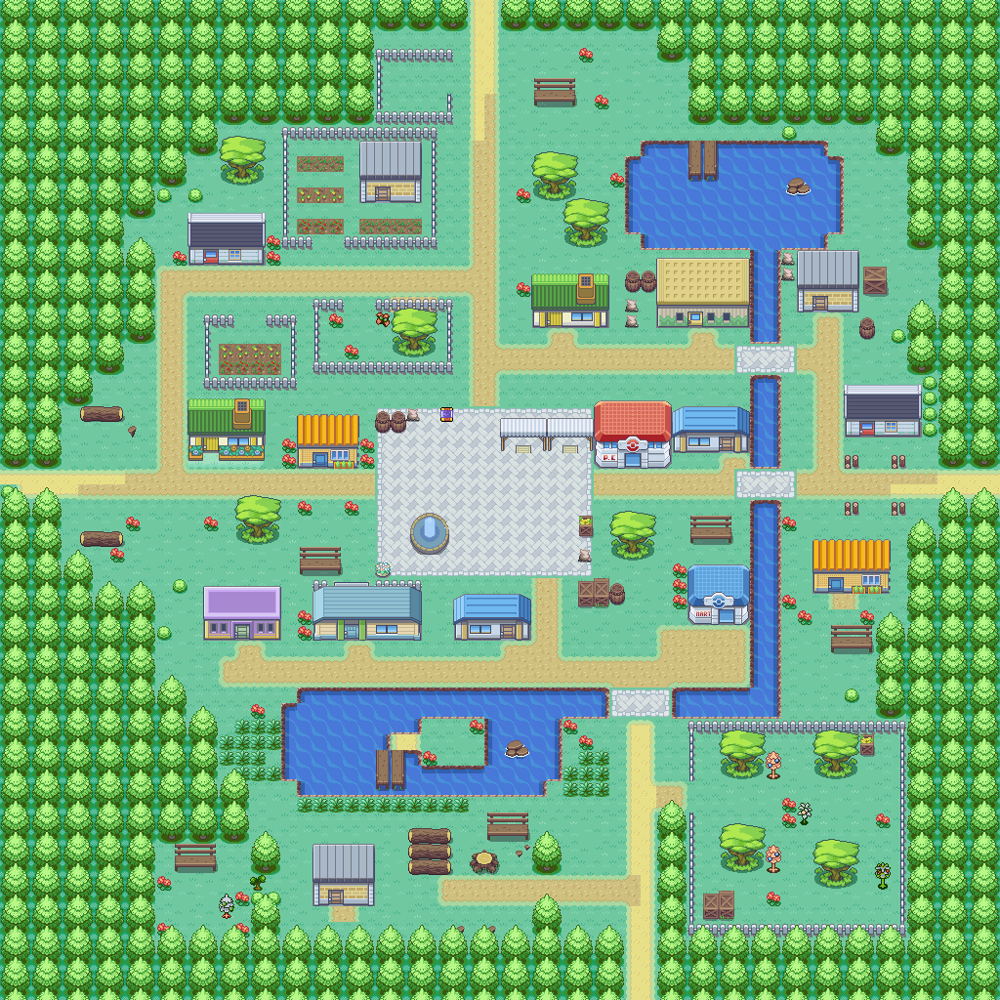 |
| 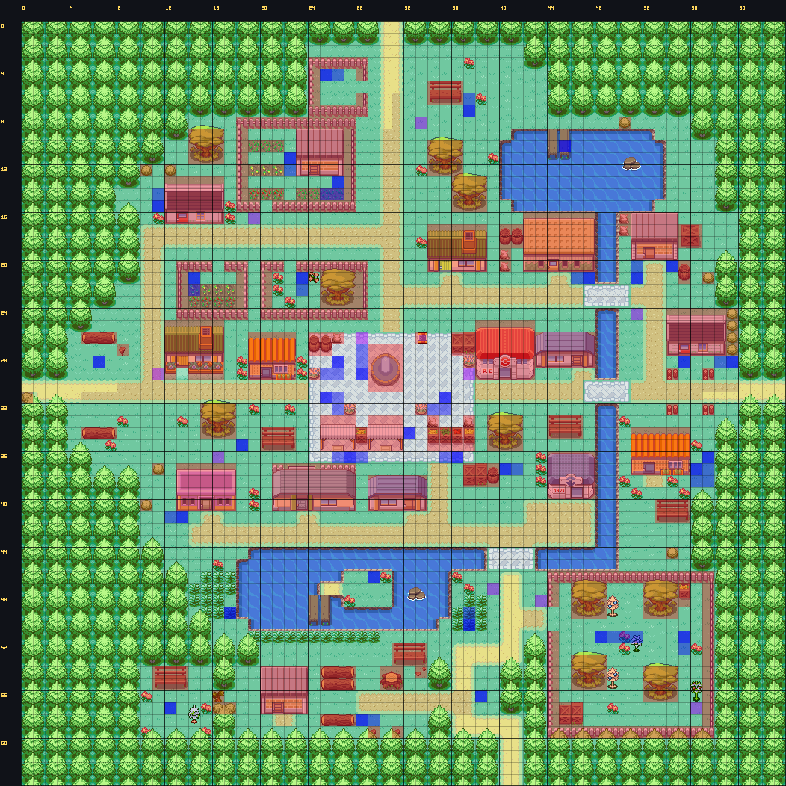 | 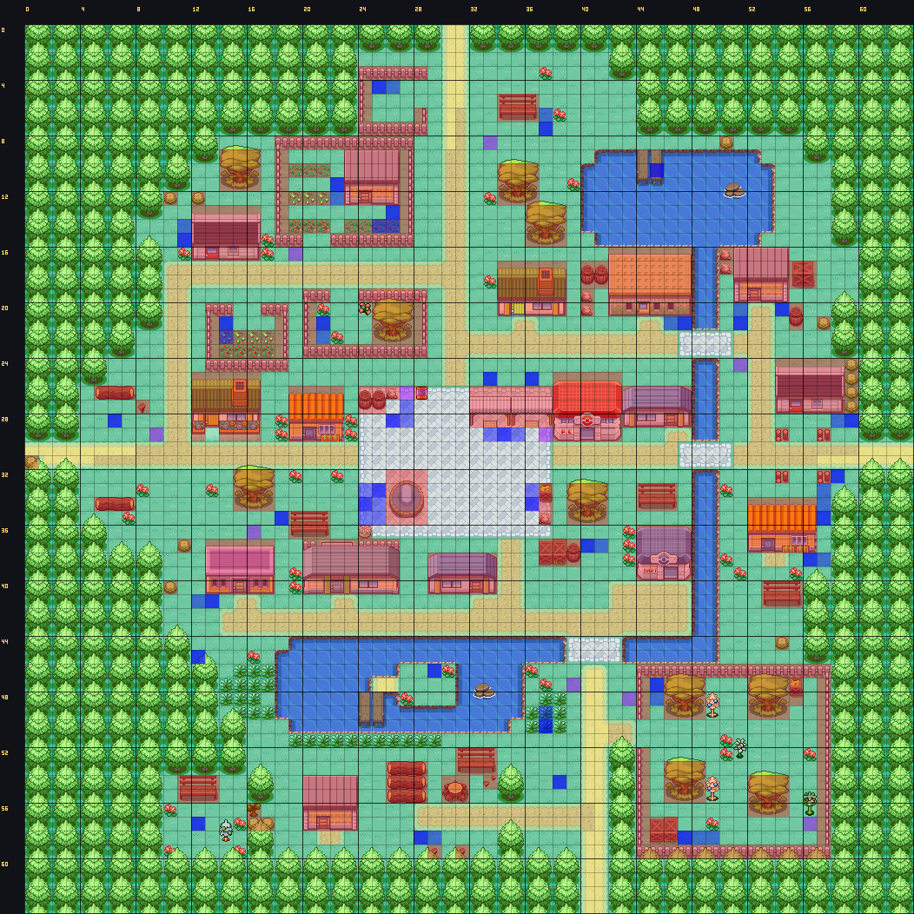 |
| 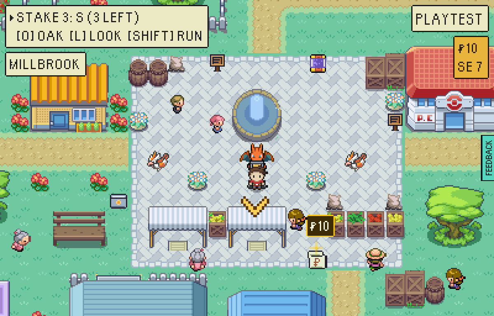 | 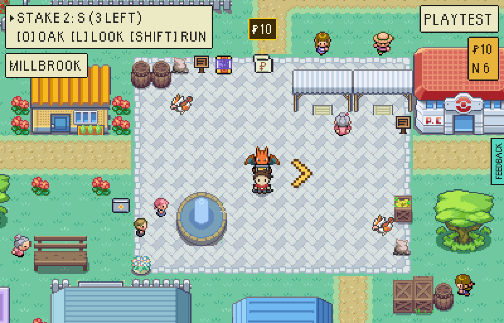 |
| 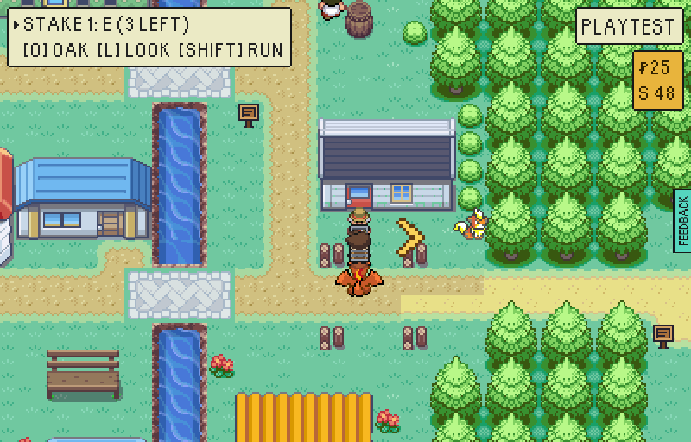 | 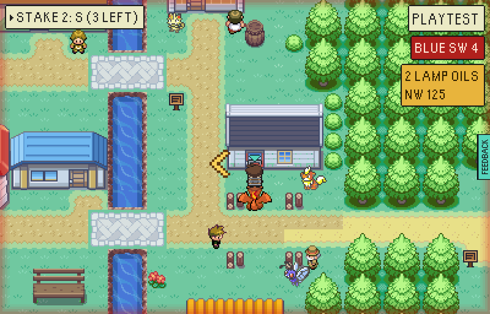 |
| 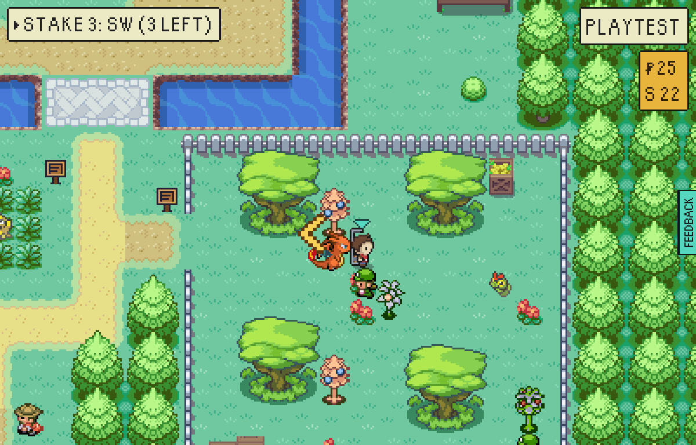 | 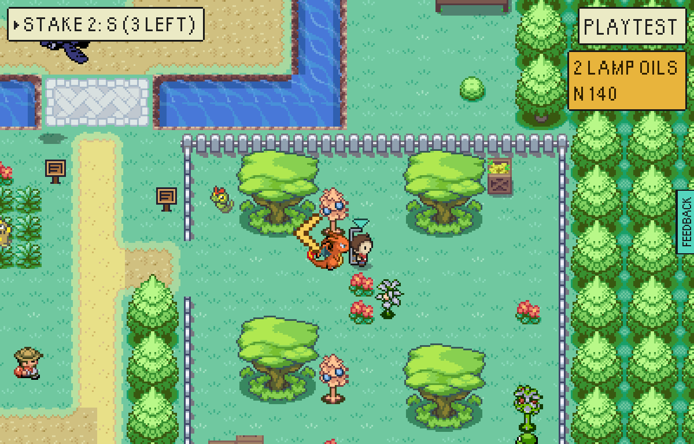 |
| 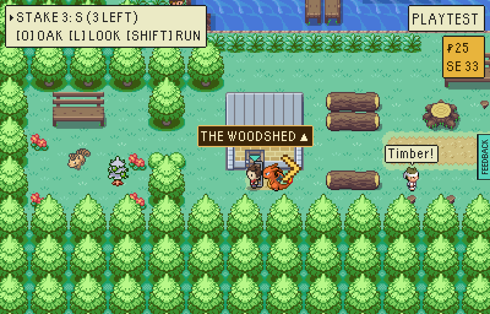 | 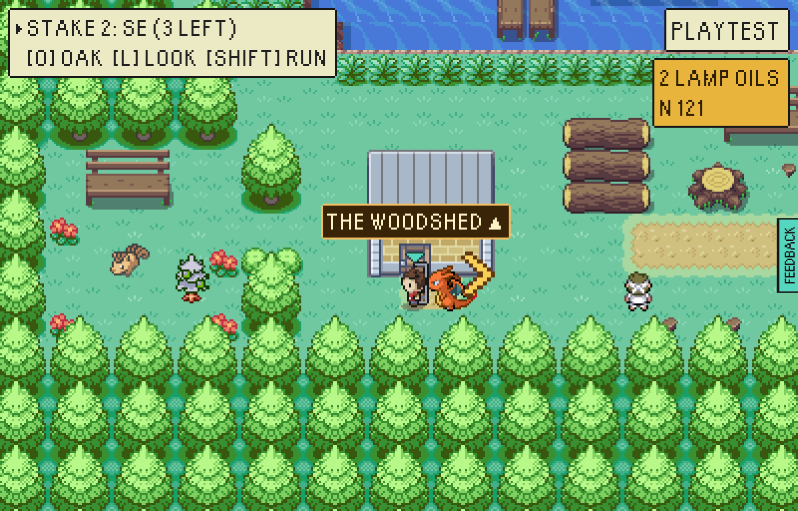 |

In the collision pictures, red is solid ground that is not wood or water and
blue is a figure and its beat.

## How they were made

- The whole-village pictures are the district program drawn alone
  (`mapPicture` from `tools/mapcraft/picture.mts`, the old program from `main`
  before this change); the collision ones add the built map's collision and every
  figure's beat over it.
- The in-game pictures and the snag lists are `walkableVillage.mjs` against two
  test-mode builds (`VITE_EPTW_TEST_MODE=1 npx vite build`), one with the old
  `greystoneVale.json` and one with the new, served under
  `/escape-from-pallet-town-web/` and driven in headless Chromium at
  `PIXEL_WINDOW`, by day, on the explorer run.
