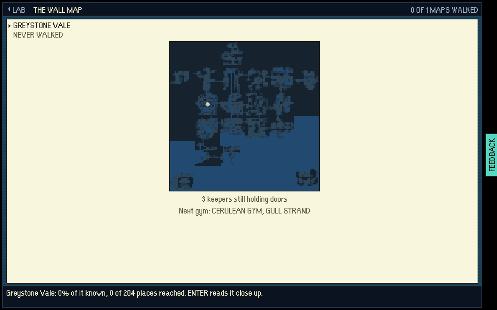
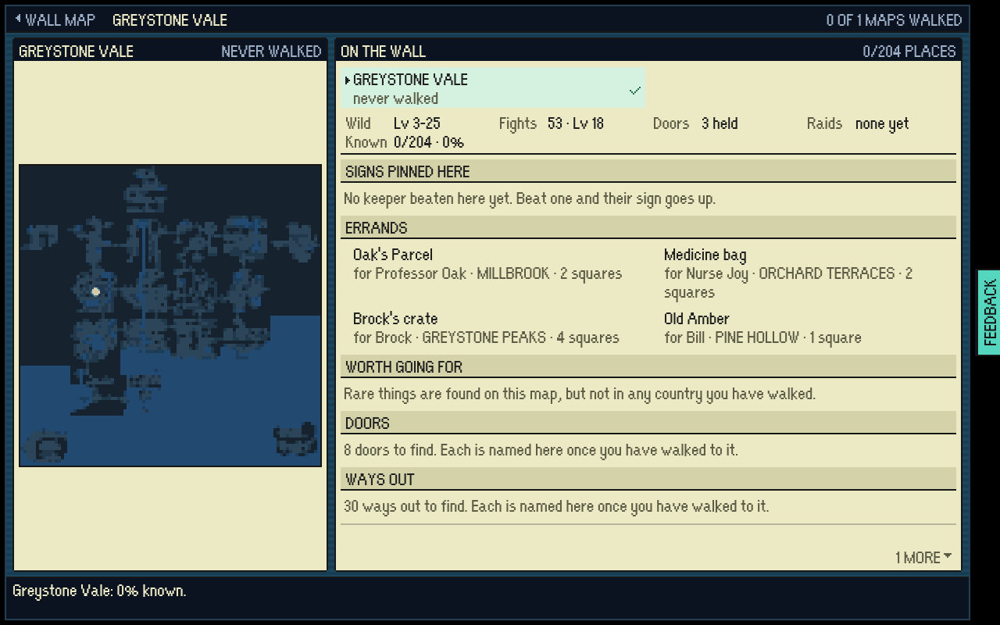
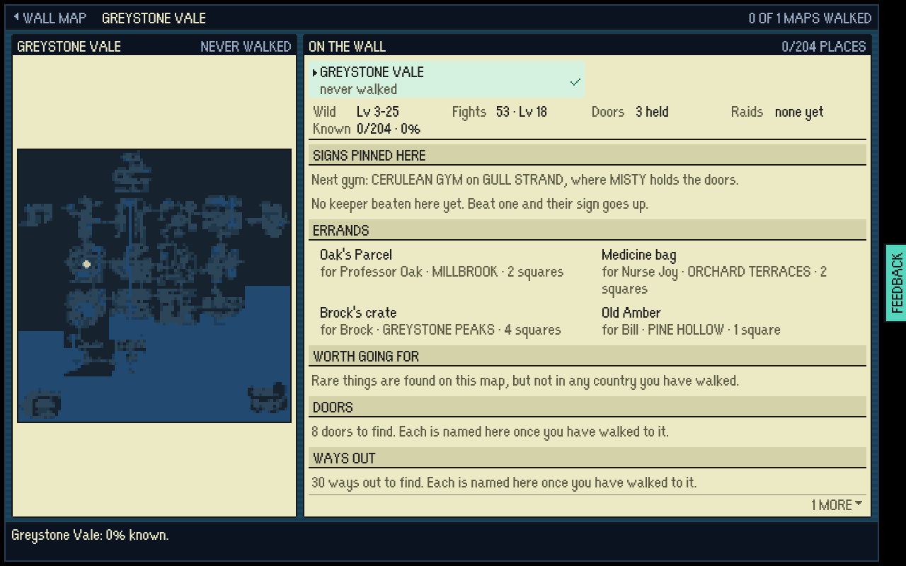

# The wall map names the next gym

Oak's Lab's wall map on a save that has beaten nobody. Before, it said only "3 keepers
still holding doors" and "No keeper beaten here yet". After, the card says which
gym is next and where, and the close-up says who holds it.

| | before | after |
|---|---|---|
| the wall |  |  |
| close up |  |  |

Made on 22 Nov 2026 with `node tools/playtest/wallMapShots.mjs <dev url> <out> --window=1280x800`.
