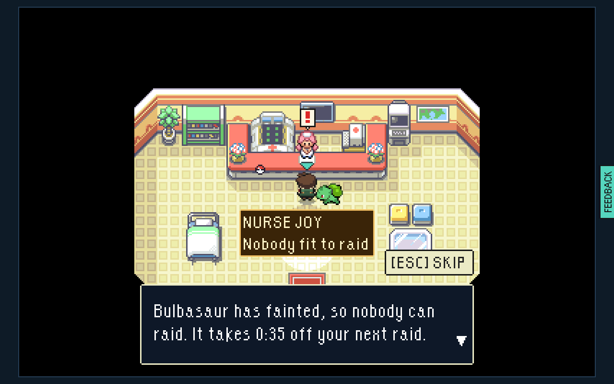
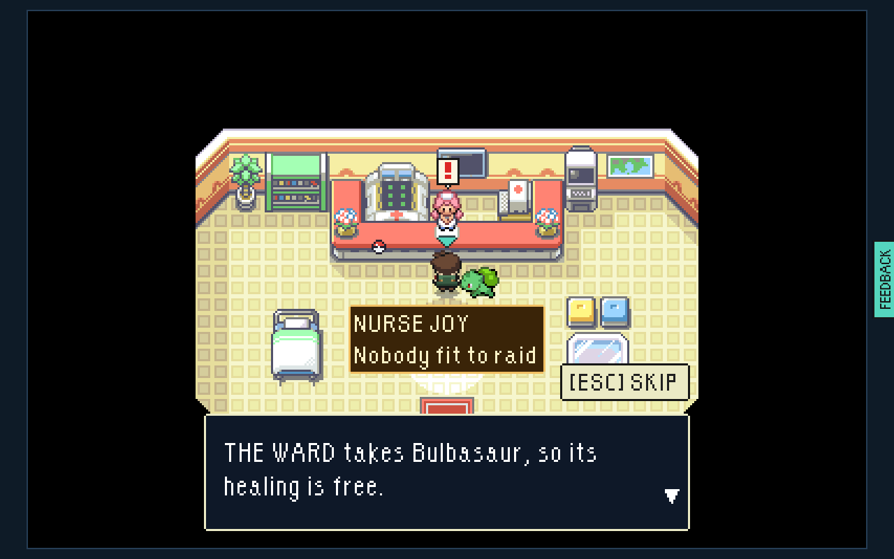

# Nurse Joy says what THE WARD does

The Pokémon Center on a save with THE WARD built (`quarantine-ward`) and its partner
fainted. Before, she said `Bulbasaur has fainted, so nobody can raid. It takes 0:35 off
your next raid.` and nothing about the ward. After, the same line is followed by `THE WARD
takes Bulbasaur, so its healing is free.` and `Bringing a Pokémon round from a faint never
is.` Once the bed is used, she says `THE WARD's bed is used until your next raid.`

| before | after |
|---|---|
|  |  |

Made on 22 Nov 2026 against the dev server in `?testmode=pixels`, walked to the counter
over the room's own collision and spoken to with SPACE.
