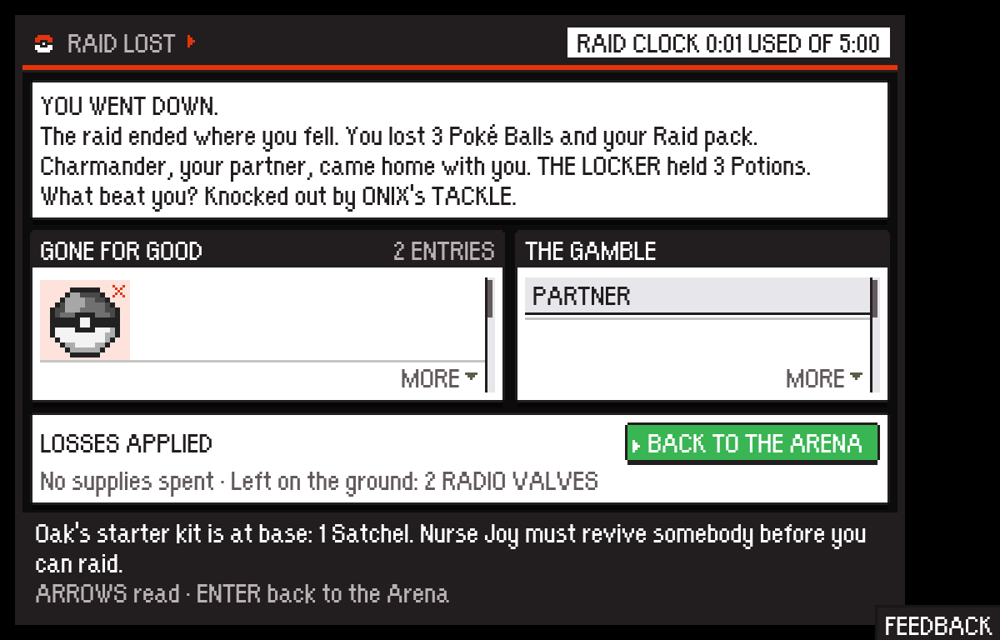

# What beat you, when the runs failed

The gyms playtest of 26 Nov 2026 wiped in Smugglers' Cove: a lone Pidgey chose
RUN against a wild Staryu, was told "Can't escape!" twice, and fell. The raid's
result said `What beat you? Damage: STARYU hit for about 9 a turn, you for about
0.` - hits the player never threw, and nothing about the runs that kept them
there.

A failed run is now a fact of its own (`whatBeatYou`'s `runsFailed`, which
`BattleScene` hands over as its count of failed wild escapes): each one weighs
two turns, a free hit for the other side and a fight the player chose to leave.
And a lopsided trade where nothing of the player's landed says so, rather than
"you for about 0".

The same set-up both times: a fresh save lands at THE QUARRY with Charmander at
12 HP, steps into the Onix guard's reach and chooses RUN until it faints, every
run made to fail by holding the escape roll high (only the roll's own call to
`Math.random`, so the Onix fights as it would - which is why it used SCREECH once before and TACKLE twice after).

Before (main), the line names only the last hit:

After, it names the runs:

Made with the AI playtester's hands (`tools/playtest/ai-player/act`) on a
test-mode build, one headless browser, the card shot at 3x.
