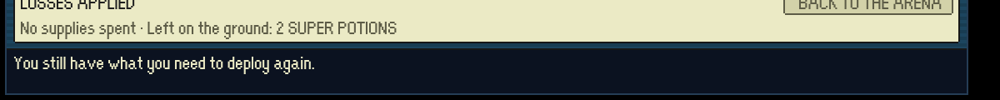
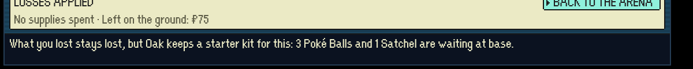

# A wipe says what Oak's starter kit put back

A lost raid's screen says what went 'gone for good', and then the settlement's
last resort (`Stash.ensurePlayable`, `restockMinimumSupplies`) quietly put a
Satchel and the balls back in the vault. Eight findings of the 22 Nov AI
playtest read that as the screen lying or a bug. The wipe's last line now says
it: `What you lost stays lost, but Oak keeps a starter kit for this: 3 Poké
Balls and 1 Satchel are waiting at base.` `SaveManager.settleWipe` measures the
restock between the loss and the refill, so it names exactly what was added.

| before (main) | after |
|---|---|
|  |  |

A fresh save deployed to Millbrook in a test-mode build at `PIXEL_WINDOW`, its
raid ended through `WorldScene.resolveExpiredRun`, the real timer-wipe path,
22 Nov 2026.
