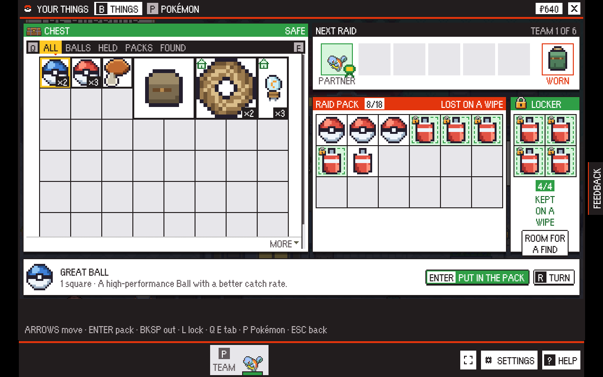
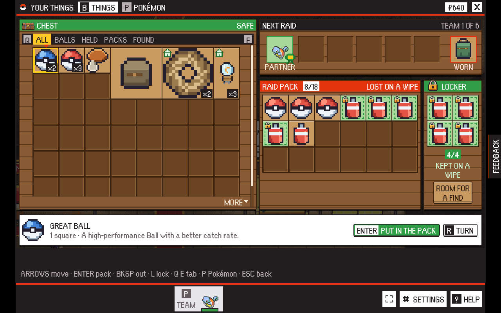
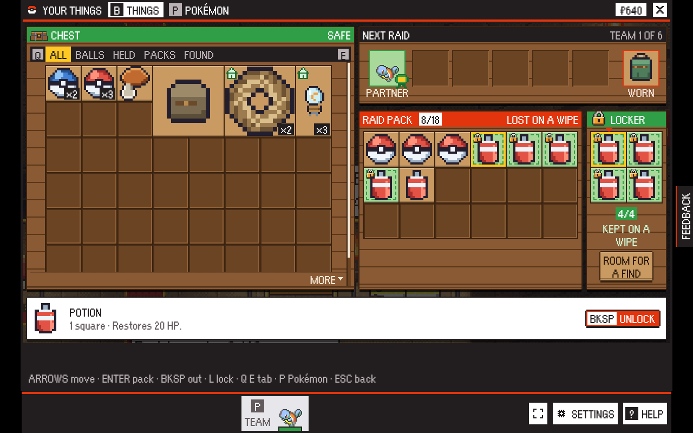
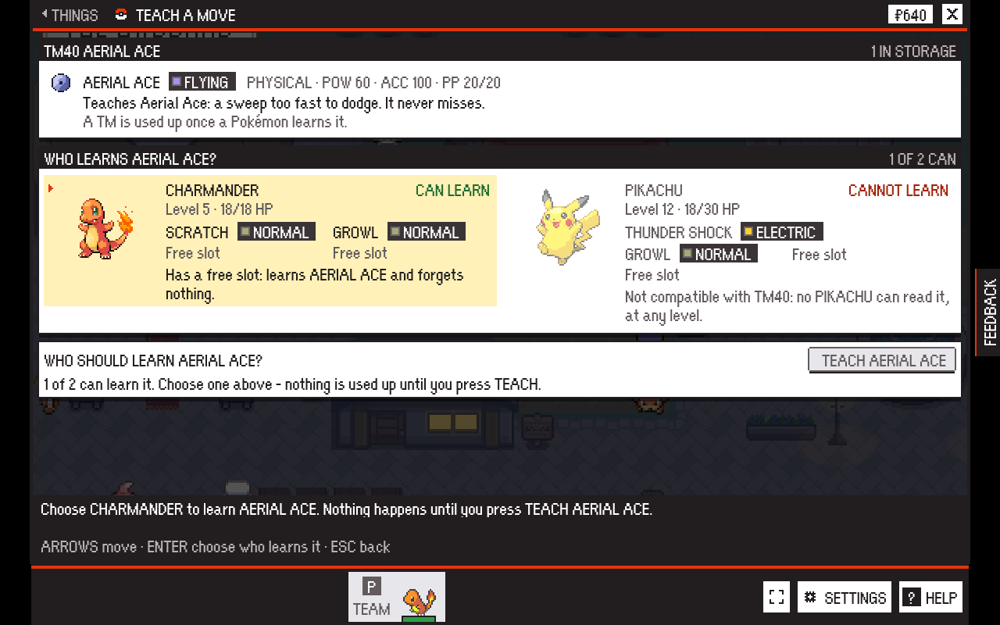
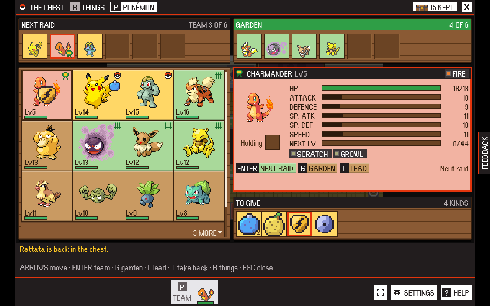

# The wood floor: white is a plate, never the floor

The captain, 26 Nov 2026, of the round-3 menus: "Some of them look great, but the ones
that just have that bright white background, they're not quite there yet, are they? And
I can't put my finger on why." A study of every menu that night found why, and he took
its picks: "Go with all of your decisions on the menu aesthetic." Two mock-ups came out of
it, one on dark trays and one on brown wood, and the next night he chose: "I actually
prefer the kind of brown ... the woody colour, over the black. The army aesthetic of
Tarkov shouldn't be used - it should all be Pokémon. It's just the mechanics of Tarkov
(extraction) that we want."

## What the study found

The menus that feel right are places with things in them: THE DAY-CARE's paddock, THE
TRADER's two Pokémon on grass, the prize window's wooden shelf. The white ones are
paperwork about things. It can be measured: the mean saturation of every pixel inside the
game's stage (`tools/playtest/colourScore.mjs`, 0 is grey or white, 100 pure colour).

| | colour |
|---|---|
| The world: the vale on a raid, the harbour by day | 35, 27 |
| Menus that feel right: prize window, a fight, the Trader, Day-Care, the raid's pack, YOUR TEAM, favours, Brock's | 55, 32, 31, 30, 26, 25, 21, 16 |
| Menus not there: YOUR THINGS, Bill's Cottage, the Chest's Pokémon, the boutique, the wardrobe, help, Bill's PC, the jump list, the full report, the Pokédex | 13, 11, 11, 10, 8, 8, 5, 4, 3, 1 |

Every screen that felt right scored 16 or more and every white one 13 or less, with no
overlap. The world has no white ground at all, so a sheet of white paper was the
brightest, greyest thing in the game, and at night nearly three times as bright as the
harbour behind it.

Five causes, in the order they are being fixed:

1. **White is the floor.** In the good menus white is a small plate of words on something
   colourful; in the weak ones it is the whole screen.
2. **Everything is flat.** A card was one fill and one thin line, with a shadow too faint
   to see.
3. **Two sizes of pixel.** The world is drawn at 3x and the menus at 2x in a 1280x800
   window.
4. **The place disappears.** A good menu shows where you are; a white one could be anywhere.
5. **Menus snap in.** One frame is the harbour, the next is the whole menu.

## The rules this folder is the record of

- **The floor of a screen is warm brown wood, or it is a place.** A card is boards, an
  empty square is sunk into them, and a thing or a button stands on a raised plate of
  lighter wood.
- **White is a plate**: the pill on a strip, a count, the description of the thing in
  hand, a question (a small window of paper, as FireRed's is), and the row under the
  cursor, which is a light bar with ink on it.
- **Wood is a middle tone**, so a board carries pictures and white labels, a raised plate
  dark ones, and a sentence goes on paper.
- **Three rules of light**: a card has a lit lip and a dark foot; an empty square is dark
  at its top left and lit at its bottom right, and a filled one the other way up; a
  shadow is drawn at full strength.
- The five colours keep their jobs: red can be lost, gold is the chosen thing, green is
  safe. No navy, blue or cream, and nothing that looks military: it is a FireRed world.

How it is built is in `docs/agents/ui-and-screens.md` ("White is a plate, never the floor").

## Every screen, as it is moved

`before/` and `after/` are the same save photographed the same way on the commit before
and the commit of each change: `node tools/playtest/menusAudit.mjs <test-mode build url>
<dir> --only=<names>` at 1280x800, and the score is `node tools/playtest/colourScore.mjs
<dir>`.

| Screen | Before | After | Colour | White |
|---|---|---|---|---|
| YOUR THINGS (B) |  |  | 11 to 49 | 37% to 11% |
| THE CHEST: its things |  |  | 11 to 49 | 37% to 11% |
| THE CHEST: its Pokémon |  |  | 8 to 57 | 37% to 1% |
| THE RAID ARENA's rack |  |  | 12 to 49 | 37% to 11% |
| THE RAID ARENA's locker |  |  | 12 to 49 | 38% to 12% |

The states a still cannot show were played with `tools/playtest/yourThings.mjs`,
`chest.mjs` and `chestPokemon.mjs`, every check passing on the wood floor:

| | Before | After |
|---|---|---|
| Teaching a disc at home |  |  |
| A stone over a Pokémon it does nothing for |  |  |
| The question before a stone is used: a plate of paper |  |  |
